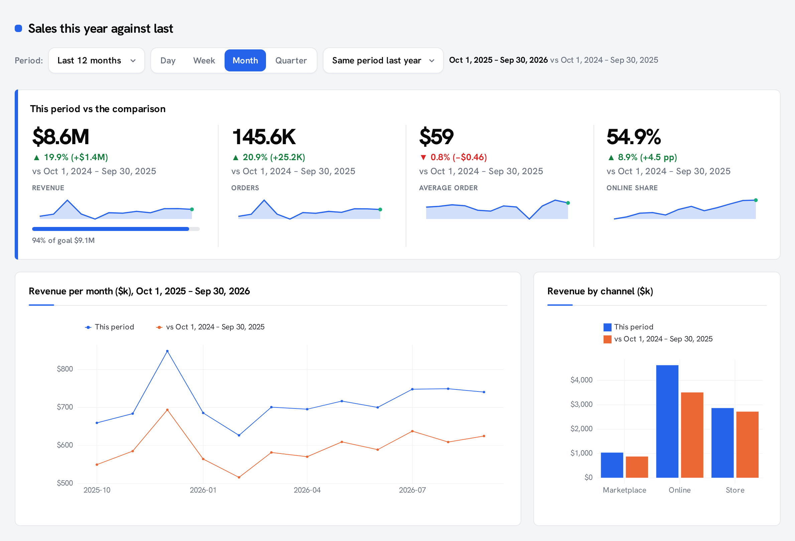

# Anofox Visualization — charts & dashboards for DuckDB, from SQL

<a href="https://datazoode.github.io/anofox-visualization/">
  <picture>
    <source media="(prefers-color-scheme: dark)" srcset="docs/img/readme-hero-dark.png">
    
  </picture>
</a>

You write ordinary DuckDB SQL and tag result columns with `::ROLE` casts. Each
annotated `SELECT` becomes a chart, a KPI, a table or an input, rendered to SVG
by [ggplot-rs](https://github.com/sipemu/ggplot-rs), a grammar-of-graphics
engine. There is no JavaScript charting library and no config file: the SQL is
the dashboard.

[](LICENSE)
[](https://duckdb.org)
[](https://datazoode.github.io/anofox-visualization/) [](https://datazoode.github.io/anofox-visualization/app/)
[](#claude-code-plugin)

> [!IMPORTANT]
> Early development: expect bugs and breaking changes. Please report them on the
> [issues page](https://github.com/DataZooDE/anofox-visualization/issues).

```sql
SELECT week::XAXIS, channel::CATEGORY, sum(revenue)::BARCHART_STACKED, 'Revenue by channel'::TITLE
FROM sales GROUP BY ALL ORDER BY ALL;
```

**[▶ Try it in the browser](https://datazoode.github.io/anofox-visualization/app/)**: the
builder runs on DuckDB-Wasm, nothing to install.

## What you can do

- **Draw charts in SQL.** 36 chart kinds (bars, lines, scatter, heatmaps, waterfalls, Sankey, Gantt, diagrams and factor graphs …) and maps (countries and regions built in, or your own geometry), as SVG from any query. [Chart catalogue](https://datazoode.github.io/anofox-visualization/build/charts/)
- **Build dashboards from a `.sql` file.** KPI tiles, tables, inputs (`getvariable`), tabs, cross-filtering, drill-down and share links. [Building dashboards](https://datazoode.github.io/anofox-visualization/build/)
- **Author in the browser.** The builder edits and renders on DuckDB-Wasm or against your own database (`anofox_serve`). [Authoring](https://datazoode.github.io/anofox-visualization/deploy/authoring/)
- **Publish without a server.** Static HTML, one SVG, or a whole static site (`dashboard --site`). [Static site](https://datazoode.github.io/anofox-visualization/deploy/static-site/)
- **Serve dashboards to others.** A locked, read-only server with login (OIDC, JWT, proxy, API keys), row and column policies, scheduled reports and alerts. [Locked server](https://datazoode.github.io/anofox-visualization/deploy/locked-server/)
- **Embed them** in your own app (a web component, or signed embed links). [Embedding](https://datazoode.github.io/anofox-visualization/deploy/embedding/)
- **Plot results from the anofox extensions.** statistics, forecast, tabular, optimize and decide: `anofox_plot(t)` picks the plot. From Python and R too. [Integrations](https://datazoode.github.io/anofox-visualization/integrate/)
- **Check dashboards in CI.** `dashboard --check` finds broken panels, design problems and implausible numbers. [CLI](https://datazoode.github.io/anofox-visualization/deploy/cli/)
- **Add your own features as modules or plugins.** Your own roles, panels, SQL macros and browser files from a separate (also private) crate: built into your own distribution, or compiled to one sandboxed `.wasm` plugin and loaded with `--plugin`. [Modules and plugins](https://datazoode.github.io/anofox-visualization/integrate/extend/)

## What it doesn't do (yet)

- **The community extension only renders.** `INSTALL … FROM community` gives SQL → SVG. The server, the builder and the `dashboard` / `serve` CLIs come with a [GitHub release](https://github.com/DataZooDE/anofox-visualization/releases) or a source build.
- **Release files are unsigned.** Load them with `duckdb -unsigned`; each release has checksums and build attestations.
- **DuckDB 1.5.6 is the release target.** 2.0 is built and tested in CI (non-blocking); the pin moves with 2.0.1.
- **No drag-and-drop.** Dashboards are SQL. The builder helps you write it; it doesn't hide it.
- **The AI assistant is off** unless an installation turns it on, and it then uses your own Claude API key. It is still being evaluated.
- **Plugins are new.** The `dashboard` CLI loads them in builds with the `plugins` feature; servers, the browser and the DuckDB extension follow ([#1213](https://github.com/DataZooDE/anofox-visualization/issues/1213)). The release builds don't enable them yet, and the interface may still change.

## Quick start

```sql
INSTALL anofox_visualization FROM community;
LOAD anofox_visualization;

-- one SVG per group, from columns
WITH sales AS (SELECT * FROM (VALUES ('app', 30), ('web', 22), ('api', 12)) t(ch, n))
SELECT anofox_bar(ch, n) FROM sales;

-- model output from an anofox extension: the plot is picked from the table
SELECT anofox_plot(c) FROM coefficients c;
```

With the full toolkit (a release or a source build):

```sql
SELECT anofox_serve(8080);                              -- the builder on this database (loopback)
SELECT anofox_serve_dashboards('dashboards', 8095);     -- serve a folder of .sql dashboards, locked
```

```sh
dashboard my_dashboard.sql out.html     # a static, interactive HTML file
dashboard --check my_dashboard.sql      # lint it
```

## Install

| You want | Get | |
|---|---|---|
| SQL → SVG in any DuckDB | `INSTALL anofox_visualization FROM community` | render only |
| The full toolkit: builder, server, CLIs | the [latest release](https://github.com/DataZooDE/anofox-visualization/releases) (Linux, macOS, Windows) | [install guide](https://datazoode.github.io/anofox-visualization/start/install/) |
| To build it yourself | `duckext/scripts/build-native.sh` (Rust stable) | [BUILD.md](BUILD.md) |

## Where to go next

- **[Website](https://datazoode.github.io/anofox-visualization/)**: getting started, the chart catalogue, the gallery, deployment guides.
- **[docs/DOCS.md](docs/DOCS.md)**: the full reference (every role, the CLI, serving, telemetry of the anofox extensions).
- **[Dashboard design](docs/dashboard-design.md)**: what `--check` enforces, and why.
- **[Secure serving](docs/secure-serving.md)** and **[deployment](docs/deployment.md)**: the trust model, logins, Docker, reverse proxies.
- **[Python & R](docs/python-r.md)**: plot statsmodels, scikit-learn or broom results.
- **[Integration CI](docs/integrations.md)**: how every anofox extension's output is rendered on every push.
- **[Writing a module or a plugin](docs/modules.md)**.

### Claude Code plugin

Five skills that document the SQL API, so Claude Code can write charts and dashboards from a plain request:

```
/plugin marketplace add DataZooDE/anofox-visualization
/plugin install anofox-visualization@anofox-visualization
```

The skills live in [`plugins/anofox-visualization/`](plugins/anofox-visualization/); every SQL block in them runs in CI.

## Telemetry

This extension sends **nothing**. It also switches off the usage telemetry of the
anofox extensions it loads, unless you set `DATAZOO_DISABLE_TELEMETRY=0`
([details](docs/DOCS.md#telemetry-of-the-anofox-extensions)).

## License

[Business Source License 1.1](LICENSE): free for development, testing, research
and internal use; hosted or embedded use for third parties needs a commercial
license until the Change Date (five years after publication), when it becomes
MPL 2.0. Contact **contact@datazoo.de**.

## Contributing & support

Pull requests are welcome (`cargo test`, and `dashboard --check` for example
dashboards). Questions and bugs: [issues](https://github.com/DataZooDE/anofox-visualization/issues),
[discussions](https://github.com/DataZooDE/anofox-visualization/discussions), or
contact@datazoo.de. If a chart renders wrong, the SQL (or the spec you passed)
is the fastest path to a fix.

A daily banner in interactive terminals asks for a star; silence it with
`SET datazoo_banner = false;` or `DATAZOO_NO_BANNER=1`.

```bibtex
@software{anofox_visualization,
  title  = {Anofox Visualization: Charts & Dashboards for DuckDB from SQL},
  author = {DataZoo DE},
  year   = {2025},
  url    = {https://github.com/DataZooDE/anofox-visualization}
}
```

Built on [DuckDB](https://duckdb.org) and [ggplot-rs](https://github.com/sipemu/ggplot-rs). © DataZoo GmbH.
