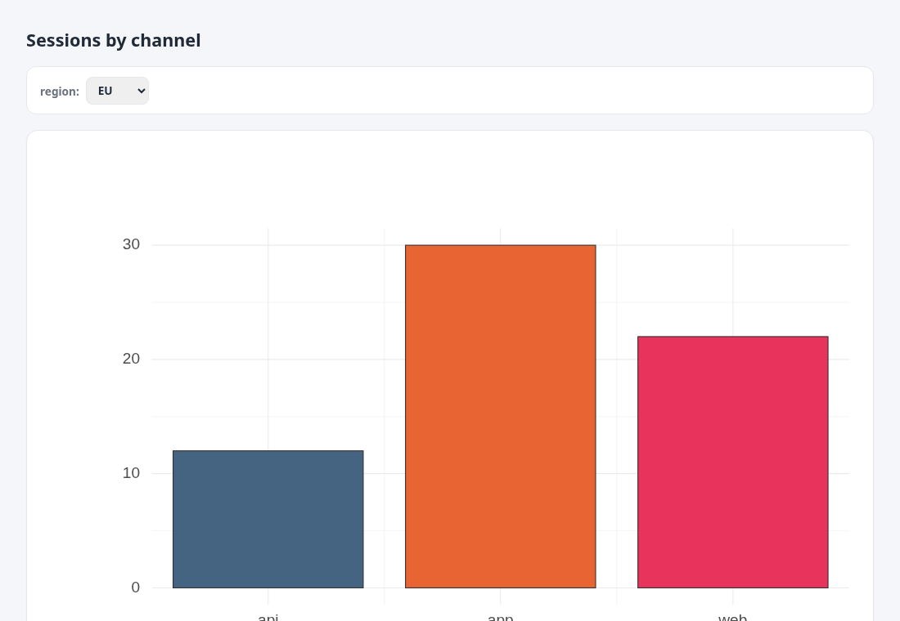

# Secure serving — trust model

**Goal.** Serve a fixed, live dashboard to *untrusted* consumers: they see
current data, but they cannot run arbitrary SQL or reach anything beyond the
dashboard they were given — while the author keeps a convenient authoring UI
that nobody else can drive.

There are three serving modes. Two run client SQL only for the author; the
other two never accept SQL from the client at all.

| | **Authoring** | **Locked, full UI (A)** | **Static render (B)** |
|---|---|---|---|
| Entry | `anofox_serve(port)` / `serve <db>` | `anofox_serve_dashboards(dir, port[, options])` | `serve --dashboards <dir>` |
| Audience | the author, on this machine | untrusted consumers (interactive) | untrusted consumers (static) |
| UI | full builder + editor | real client, editor removed | server-side SVG only |
| What the client sends | SQL (`POST /query`) | `{dashboard, panel, vars, page}` (`POST /api/panel`) — **no SQL** | dashboard id + whitelisted `?param=` values |
| Database | the live read-write session / file | private read-only snapshot (refreshable), locked config; optionally one data folder | `duckdb -readonly`, locked config |
| Bind | loopback only (enforced) | `bind` option (default `127.0.0.1`) | `--bind` (default `127.0.0.1`) |
| Access control | loopback `Host`, same-origin, per-server token | same-origin `POST`; login via an auth proxy (`options.auth`); row and column policies (`options.policy`) | login via an auth proxy (`--auth`); no policies |

Available in the **from-source build** only (`duckext/`, see
[`BUILD.md`](../BUILD.md)); the community extension is render-only.

**The AI assistant (#204) is not available on any served or embedded
page** in this release — `assistConfig()` turns it off for `served`,
`embed` and the `live` backend unconditionally, regardless of
`app-config.json`. It stays available only on static hosting (mode-free,
no server at all) and on the authoring UI's DuckDB-Wasm path. A real CSP
*header* (not a meta tag, with nonces and `frame-ancestors 'none'`) for a
future served `/assist` is a follow-up issue.

---

## Authoring — `anofox_serve(port)` and `serve <db>`

Runs whatever SQL the builder sends, against your live data. That is the point,
so the protection is about making sure *only you* can send it:

- **Loopback only.** The extension always binds `127.0.0.1`; the `serve` bin
  refuses a non-loopback `--bind` in authoring mode.
- **Per-server token.** A random 128-bit token is generated at start. The URL
  that is printed (and opened) carries it once — `http://127.0.0.1:8080/?token=…`;
  the server answers with a redirect that stores it in an `HttpOnly;
  SameSite=Strict` cookie (`anofox_token_<port>`). Every request needs the
  cookie or an `X-Anofox-Token` header; otherwise `401`.
- **DNS rebinding.** The `Host` header must be a loopback name for this port
  (`127.0.0.1`, `localhost`, `[::1]`); anything else is `403`.
- **CSRF.** A request whose `Origin` differs from the `Host` it was sent to is
  `403` — including pages on *other* localhost ports (cookies are shared across
  ports, origins are not). A `text/plain` form/fetch POST from a web page
  therefore never reaches the SQL endpoint.
- **Check, server-side (`/check`, #199).** The builder's Check button
  (`dashboard --check`'s own diagnostics) needs a scratch session to run its
  queries in without touching the live data — DuckDB-Wasm has one
  (`web/lint.js`'s `scratchRunner`), but a live backend has none, so this
  endpoint runs the whole lint on the server instead: `POST /check` with
  `{"script", "strict", "design", "timeout_ms"}` (the body `dashboard
  --check --strict --no-design` would take, plus `timeout_ms` — default
  30,000, at most 120,000), behind the same token/cookie, `Host` and
  `Origin` checks as `/query`. Its queries never run on the live session's
  own connection: a second connection, opened once at start-up next to the
  live one, is ATTACHed its own `:memory:` scratch database per call
  (switched into with `USE`, ahead of the live database on `search_path`,
  DETACHed after) — a `CREATE TABLE`/`VIEW`/`MACRO` or `SET VARIABLE` the
  checked script runs lands there, never on the live database, while the
  live database's own tables stay readable (an input's or `::SELECT_AS`'s
  default needs real rows). A hung or slow checked query past `timeout_ms`
  is interrupted (`duckdb_interrupt`, like the locked server's own
  `timeout_ms`) rather than holding that one connection forever — the
  interrupted query's own error becomes an ordinary diagnostic, plus one
  more `check/timeout` diagnostic, and the connection is cleaned up and
  reused normally by the next check. There is only the one check
  connection, so a second `/check` while one is still running answers `503`
  immediately instead of queuing. Returns `{"diagnostics", "ok", "summary",
  "spans"}`, the same shape the browser's own check settles to. Not
  available on the locked server (`anofox_serve_dashboards`): that one never
  accepts SQL from the client at all, checked or not.
- **No CLI meta commands in the text you send** (`serve` bin). It runs SQL
  through the `duckdb` CLI. A body (or `--init` script) with a line that
  starts with `.` is refused, so `.shell`, `.read`, `.output`, … from the
  client's own text never reach the CLI. The server feeds each body to its
  session as a file in a private directory (`.read`), followed by two end
  markers that carry a new random nonce per request; that staged file is
  made read-only once written. This is not a sandbox: authoring SQL already
  runs read-write with external access as the author, so it can still write
  `.shell …` into a config file such as `~/.duckdbrc` it controls — the
  refusal only stops a dot command in the request's own text.
- **One session** (`serve <db>`, #275). Like `anofox_serve(port)`, the
  builder talks to one DuckDB session for the whole run, shared by every
  tab. What a statement leaves (ATTACH, TEMP tables, views and macros, `SET
  VARIABLE`, `LOAD`, `SET`, `USE`) is there for the next one — including a
  transaction: a `BEGIN` or a failed statement in one tab leaves every
  tab's queries failing until that session's `ROLLBACK`. Restart `serve`
  for a clean session. The database file stays open, and locked, while
  `serve` runs. If the CLI exits, the next query starts a new session and
  the error says so.
- **A round that doesn't finish in `--query-timeout` (default 120 s)
  restarts the session** (`serve <db>`, #304). The one long-lived CLI's
  stdin is the pipe the server writes every round's staged query to, so a
  body that reads it (`read_csv('/dev/stdin')`, `COPY … FROM '/dev/fd/0'`,
  `COPY … FROM STDIN`, any case) would otherwise block forever waiting for
  more of that pipe — and so would any other query that simply hangs. Past
  the timeout the `duckdb` child is killed and the next query starts a
  fresh session (ATTACH, TEMP objects and variables are gone), the same
  recovery as the CLI exiting on its own. A literal `/dev/stdin`,
  `/dev/fd/0`, `/proc/<pid|self|thread-self>/fd/0` or a bare `FROM STDIN`
  — case-insensitively, with repeated `/` and `/./` path segments collapsed
  — is refused up front (`400`) before it ever reaches the CLI, the same
  way a dot-command is; this fast path is best-effort only (a path built at
  query time, e.g. string concatenation, is not caught by it) and the
  timeout is what actually bounds the hang either way. The watchdog that
  enforces it waits on a channel rather than sleeping the full timeout, so
  a fast round's watchdog thread exits (and is joined) right away instead
  of staying parked — a query loop doesn't build up one thread per round —
  and the session's `duckdb` child is never reaped elsewhere while a
  watchdog that might still signal it is still running. Unix only: `serve`
  has no watchdog on Windows (best-effort there, see the deployment notes),
  so a hang's only backstop there is the fast path above. `--query-timeout`
  applies to authoring only; passing it with `--dashboards` is a usage
  error (that server's own `--timeout` bounds a query there instead).
- **The private session directory is cleaned up even if `serve` is
  killed** (`#304`). `anofox-session-*` (its staged queries) is removed on
  a normal exit as before, and now also on SIGINT/SIGTERM (Ctrl-C, `kill`):
  a signal handler sets a flag a background thread polls, which removes the
  directory and exits — the default "just die" disposition never ran the
  Rust destructor that did this, so every kill used to leave the directory
  (and, if one was in flight, that round's query text) behind. Best-effort;
  a `kill -9` or a crash still cannot run any cleanup code.
- Body limit 4 MiB; authoring results are capped at 1,000,000 rows.

`SELECT anofox_serve_stop(port)` stops an extension server.

## A. Locked, full UI — `anofox_serve_dashboards(dir, port[, options])`

Serves the real browser client for every `.sql` file in `dir`
(`/` lists them, `/d/<id>` opens one; ids are restricted to `[A-Za-z0-9_.-]`).

**The server owns the SQL.** The dashboards are planned on the server at
startup; the client never sends SQL. To run statement *n* of dashboard *id* it
POSTs

```json
{"dashboard": "sales", "panel": 3, "vars": {"region": "EU"},
 "page": {"limit": 10, "offset": 20, "sort": "Region", "desc": false, "filter": "app"}}
```

- `vars` values must be JSON strings, numbers, booleans, `null` or flat lists of
  those; they become **typed SQL literals** (`'EU'`, `5`, `TRUE`, `['a','b']`) in
  `SET VARIABLE <name> = <literal>`; names must be identifiers. Objects, nested
  lists, NUL bytes and oversize values are rejected — there is no way to turn a
  value into an expression or a subquery.
- `page` (for `::PAGED` tables) is structural: the server builds the
  `COUNT(*)` / `ORDER BY` / `LIMIT` / `OFFSET` query itself (and the statistics,
  column-profile and distinct-values queries); column names are quoted as
  identifiers and the full-text filter and column-filter values are bound as
  **prepared-statement parameters**.
- Unknown fields, dashboards or panels are rejected (`400`/`404`). There is no
  `/query` endpoint (`410`).
- Every statement of every dashboard is checked with DuckDB's own parser at
  startup (exactly one statement each); panels execute as single prepared
  statements.

**Read-only, locked-down snapshot.** At startup the server copies the session's
databases (`COPY FROM DATABASE`) into a **private, randomly named `0700`
directory** and opens them in a **separate DuckDB instance**:

- every attached DuckDB database (not just the current one) is re-attached
  `READ_ONLY` under its original name; non-DuckDB catalogs (Postgres, SQLite, …)
  are *not* snapshotted and are reported as warnings — expose what you need
  through tables in a DuckDB database (pass `'{"attach": false}'` to snapshot only
  the current database);
- extensions loaded in the session, `-- @load <ext>` header lines and
  `options.load` are loaded first;
- then `enable_external_access = false` (no file or network access — `COPY … TO`,
  `read_text`/`read_csv`, `ATTACH`, `INSTALL`, `LOAD` are all refused), extension
  auto-install/auto-load and community extensions are off, and
  `lock_configuration = true`, so no statement can undo any of it;
- on unix the snapshot files are unlinked as soon as they are attached (the open
  handles keep working); the directory is removed when the server stops
  (`anofox_serve_stop`) or a start fails. On Windows the files remain until stop.

**Refreshing the snapshot.** The snapshot is taken at startup and can be
rebuilt while the server runs — no restart, no failed requests:

- `options.refresh_s` rebuilds it every *n* seconds in the background;
  `SELECT anofox_serve_refresh(port)` rebuilds it now (from the session that
  started the server, so it sees that session's *committed* data) and returns
  once the new one serves. Rebuilds never overlap: an on-demand refresh waits
  for a running one, the interval refresher skips its turn.
- The swap is atomic: a request takes the current snapshot when it starts and
  finishes on it; later requests get the new one. The old snapshot (its
  DuckDB instance and its directory) is closed and deleted when its last
  request ends.
- Each snapshot has its own result cache, single-flight and supersession
  table, so nothing is cached, shared or cancelled across snapshots; the
  ETags carry the snapshot's epoch.
- A failed rebuild leaves the current snapshot in service; the error goes to
  the log (and to the caller of `anofox_serve_refresh`).
- `GET /healthz` reports `version` (the build version, #216), `epoch` (1 at
  start, +1 per refresh), `snapshot_age_s`, `refresh_s`, `refreshing` and
  `refresh_failed` (no error text — `/healthz` is public), and `limits`: the
  effective limits (`threads`, `max_queries`, `max_rows`,
  `max_response_bytes`, `max_inflight_bytes`, `cache_bytes`, `timeout_ms`,
  `memory_limit`, `duckdb_threads`) and their use (`queries_running`,
  `queries_waiting`, `inflight_bytes`, `inflight_peak_bytes`,
  `refused_inflight`, `refused_queries`). With `auth`, a caller that is not
  signed in through the proxy gets only `{"status":"ok"}`; `version` (like the
  rest of this body) appears only without `auth`, or for a caller signed in
  with no dashboard scoping.
- While a rebuild runs, the old and the new snapshot both exist: plan for twice
  the snapshot's disk and memory.

There is no HTTP endpoint for refreshing: it is a SQL call in the serving
session (or the interval), so no viewer can trigger one.

**A live data folder (`options.data`).** Data that is too large or changes
too often to copy at every refresh — e.g. a folder with one parquet directory
per forecast run — can be read in place:

```sql
SELECT anofox_serve_dashboards('dashboards', 8095,
  '{"data": "/srv/runs", "path_vars": ["run"]}');
```

```sql
-- a panel: the run is picked by a variable (a dropdown, a ?v.run= link, …)
SELECT ds::XAXIS, yhat::LINECHART
FROM read_parquet(getvariable('anofox_data') || '/' || getvariable('run') || '/forecast.parquet');
```

- The folder (canonicalised: no `..` or symlink in the configured path) is
  the only path the snapshot instance may open — DuckDB's
  `allowed_directories` with `enable_external_access = false` and
  `lock_configuration = true`. DuckDB refuses any path outside it, including
  `…/run/../../etc`.
- **Keep it narrow.** Every viewer can read every file in it. The server
  refuses `/`, top-level system directories (`/etc`, `/home`, `/tmp`, `/usr`,
  `/var`, …) and any folder that contains the home directory or the temp
  directory (where the snapshots live); point it at the folder that holds the
  served data and nothing else.
- Each request gets `SET VARIABLE anofox_data = '<folder>'` after the viewer's
  variables; a viewer can't set `anofox_data` (`400`).
- `path_vars` lists the variables whose values become path segments: each
  value must be a plain name — `[A-Za-z0-9_.-]`, not starting with `.` (so not
  `.`, `..` or a hidden file), no `/` — a non-negative integer, or `null`;
  anything else is `400` before any SQL runs.
- **Read-only — make it so in the OS.** DuckDB has no read-only form of
  `allowed_directories`: a statement that writes (`COPY … TO`, `EXPORT`,
  `ATTACH`, …, or anything that runs one: `EXPLAIN ANALYZE`,
  `PREPARE`/`EXECUTE`) could write into the folder. The **hard guarantee** is
  the operating system's: mount the folder read-only into the server
  (`-v /srv/runs:/srv/runs:ro`, a read-only bind mount) or give the server's OS
  user read permission only.
- On top of that, with `data` set the server only starts if every dashboard
  statement is classified as harmless by DuckDB's own parser
  (`json_serialize_sql`, which parses without running and accepts only
  `SELECT` statements): panels must be queries (`SELECT`, `WITH`, `FROM`,
  `VALUES`, set operations; a `PIVOT` only as a subquery with its `IN (…)`
  values listed), and setup statements must be queries, `SET VARIABLE <name> =
  <expression>` or `CREATE [OR REPLACE] TEMP TABLE|VIEW <name> AS <query>`
  with a query that passes the same check (the same classifier the
  [access policy](#row-and-column-policies-access-control-p2) uses). Everything else — `EXPLAIN`,
  `PREPARE`, `EXECUTE`, `CALL`, `PRAGMA`, `COPY`, `INSERT`, macros, … — fails
  the start. The check needs DuckDB's `json` extension (loaded into the
  snapshot automatically; without it the server refuses to start).
- **`-- @requires` paths** ([DOCS](DOCS.md), *Not available*) are checked
  on the server before a statement runs: a setup statement whose input is
  missing is skipped, a panel answers `400` *optional input missing: no files
  found …*, which the page shows as *Not available* (also under an access
  policy: the message carries no data). The rule for a path:
  - `${name}` takes the request's value of a **server-side** variable only:
    `anofox_data`, a `path_vars` variable (already a plain name), a
    credential's locked variable, a login claim, or one the dashboard's own
    statements set (`SET VARIABLE rd = getvariable('anofox_data') || '/' ||
    getvariable('run')`). A variable the viewer sets that is none of these, or
    an unset one, is not expanded: that alternative counts as missing.
  - **Patterns only from the author's text.** A dashboard variable can carry
    a viewer's value (`… || getvariable('q')` with a free `q`), so a variable's
    value containing a pattern character (`*`, `?`, `[`, `]`, `{`, `}`) is
    refused: that alternative counts as missing. Patterns written in the
    `@requires` line itself (`*/forecasts.parquet`) work.
  - The expanded path, resolved against the folder when relative, must stay
    inside it: no `..` segment, no `~`, no URL, no backslash or control
    character, no absolute path outside the folder — such an alternative counts
    as missing without touching the file system (the log says why).
  - **Matches are confined too.** `glob()` lists *through* a symlink that
    points out of the folder (DuckDB refuses only the read), so the server
    resolves the matches one by one (at most 1,024 per pattern, stopping at
    the first) and counts only one whose real path is inside the folder. A
    pattern whose first 1,024 matches all lead out of the folder counts as
    missing (fails closed; the log says so).
  - Any error of the check (a refused path, a glob DuckDB rejects, a timeout,
    a request superseded mid-check) counts as missing for that request; the
    details go to the server log only, never to the viewer.
  - Definite answers (also "missing") are remembered for 5 seconds per
    expanded path (at most 4,096), so a recursive pattern is not rescanned by
    every request. A failed or interrupted check is never remembered, so no
    viewer can make a file "missing" for the others. The memory is shared:
    from the response time a viewer may tell whether someone checked the same
    path in the last 5 seconds (as with the panel cache) — only for paths that
    viewer can build themselves.
  - The viewer learns only *available / not available*, about files in the
    folder, which every viewer may read anyway. Without a data folder the
    snapshot can open no files, and nothing is checked in advance: the
    statement's own error decides, as before.
  - **A tab's `@requires`** (above a `::TAB` / `::SUBTAB`) applies to every
    panel in its section, decided where the tab stands (with the variables
    set above it, as the page decides): the tab's statement and each of its
    panels answer *Not available* when it is not met, so a hidden tab's
    panels never run — also when a viewer asks for them directly. Setup
    statements in the section run as before (only their own `@requires` can
    skip them), and so do chrome directives (`::THEME`, `::ASOF`, …), which
    apply to the whole dashboard wherever they sit: keep them above the first
    tab. At runtime a viewer learns from a hidden tab only what a panel's
    *Not available* tells: whether the tab's files exist, by the same rule
    and check. **Hiding a tab is presentation, not secrecy:** the served page
    carries the dashboard's SQL, so its source still lists the tab, its
    `@requires` lines and its panels' SQL (never the data folder's path).
  - **A `::VIEW` alternative's `@requires`** (#214) is gated the same way, as
    a third level under `::TAB` / `::SUBTAB`: a direct request for a hidden
    alternative's marker or any of its panels answers *Not available*,
    whoever asks, and the group's other alternatives are unaffected. Which
    alternative a viewer is looking at is never sent to the server — it is
    not a DuckDB variable, never part of an `/api/panel` body and never part
    of a cache key, so `?view.<id>=` in the URL is a client-only bookmark:
    the script-free server ignores it (it reads only declared `@param`s), and
    a locked server's response to `/d/<id>` does not change with it.
    **Showing one alternative by default is presentation, not secrecy:** a
    non-hidden alternative's panels can be requested directly whether or not
    it is the one currently shown, exactly like a shown tab's — they carry
    only data the viewer may already read, gated by the same scope, claims,
    `@vars` and policy as any other request.
  - **A viewer can skip a setup statement that carries `@requires`** (by
    picking a run without the file). Never guard a statement that narrows what
    a viewer sees with it — neither a statement that reads no file
    (`dashboard --check` warns: `requires/on-setup`) nor one that reads a file
    *and* filters rows (`CREATE TEMP VIEW v AS … WHERE r IN (SELECT … FROM
    read_csv('allowed.csv'))`: no warning, the lint can't tell). Access policy
    views are unaffected: the server creates them before any dashboard SQL.
- Error messages sent to viewers show the folder as `<data>`; the log keeps
  the full path.
- Files appear live: a new run is readable as soon as it is written, without a
  refresh. Parquet footers are cached across requests (`parquet_metadata_cache`,
  set by the server and locked) — and kept in RAM well past what `memory_limit`
  counts for them, bounded only by the footer sizes of the files the panels can
  reach and dropped on a refresh ([`deployment.md`](deployment.md) §6). DuckDB
  re-checks each file's size and modification time (to the second) before
  using a cached footer: publish a run by writing a new file and renaming it
  into place (`mv`), which is always read fresh. A file overwritten in place
  at the same size within the same second, or with its mtime restored, can be
  read with its old footer until a refresh. The result cache does *not* see
  file changes — runs that are rewritten in place need a refresh (which starts
  a new cache) or `cache_mb: 0`.
- Views in the session over files in the folder (`CREATE VIEW v AS SELECT …
  FROM read_parquet('/srv/runs/…')`) are copied into the snapshot as views and
  read the files live too.
- Every viewer can read every file in the folder (by any `path_vars` value):
  serve one folder per audience. (DuckDB 1.5 resolves symlinks, so reading
  through a link inside the folder that points outside it is refused too. A
  `glob()` pattern still *lists* such a file's name: keep links out of the
  folder, or don't give panels a viewer-chosen pattern. The server's own
  `@requires` check counts only matches inside the folder, see above.)

**The served nav keeps `path_vars` across dashboards (#407).** Clicking
another dashboard in the served nav (`web/app.js`'s `.served-nav`, injected
whenever 2+ dashboards are served or `nav_picker` is set) carries the
*current* value of every `path_vars` variable along — `/d/monitor_features?v.model=car_price_unlabelled` —
so switching pages doesn't fall back to the target's own default:

- The server tells the page which variables are `path_vars`
  (`window.__served.pathVars`, config, not secret — every viewer already
  knows the server runs with a data folder from the dashboard's own SQL).
  The page reads the *current* value of each from `dpVars` (whatever a
  `::DROPDOWN`/`::BUTTONS` bound to it, or the `nav_picker` below, last set)
  and appends it to every nav link's `href` as `?v.<name>=<value>` — real
  hrefs, kept current on every run (`syncUrlState` → `refreshServedNavHrefs`
  in `web/app.js`), not just a click handler, so a middle-click / "open in
  new tab" carries it too. A variable with no value yet is left off the
  link; the target then falls back to its own default, same as opening it
  fresh.
- **Only `path_vars` values are ever carried** — never another viewer input,
  a selection or a filter — and they are already validated server-side on
  *every* request regardless of where they came from (`check_path_values`,
  above): the client only URL-encodes them, it adds no new trust boundary.
- A target dashboard that doesn't read a given `path_vars` name simply
  ignores it: `/api/panel` accepts any well-formed variable name
  (`parse_panel_request` only checks it's an identifier and not reserved,
  never that *this* dashboard uses it) and a panel is sent only the
  variables its own dependency analysis says it reads (#210) — so an unused
  `?v.<name>=` on the URL, or in the request body, is dead weight, not a
  `400`. (A dashboard that restricts viewer variables with its own
  `-- @vars` is the one exception: list the path variable there too, or a
  carried-over value is silently dropped for that dashboard, same as any
  other viewer input it doesn't allow.)
- **A `path_vars` name a scoped credential locks (an embed link's `vars`) is
  never carried** (security review of #410, M1): `window.__served.pathVars`
  leaves it out (`served_index`, `var_locked`). Its value always wins over
  whatever a nav link, the viewer or `nav_picker` would otherwise set
  (`Scope::lock_vars`, `locked_panel`), so carrying it would be pointless —
  and, for `nav_picker` below, worse than pointless.
- `serve --dashboards` (the script-free static render, mode B) has no
  `path_vars` or `data` folder at all — it whitelists literal `-- @param`
  values instead, a different mechanism — and no persistent cross-dashboard
  nav bar either (only the `/` list page, `page::landing`): there is nothing
  to carry a value across there. This note exists so a future `data`/
  `path_vars` on that server isn't assumed to inherit this nav behaviour for
  free.

**A nav-bar picker for a `path_vars` variable (`nav_picker`, #407).** Every
per-model dashboard repeating the same `::DROPDOWN` is instead one dropdown
in the nav bar that sets the variable for every page:

```sql
SELECT anofox_serve_dashboards('dashboards', 8095, '{
  "data": "/srv/models", "path_vars": ["model"],
  "nav_picker": {"var": "model", "label": "Model",
                 "sql": "SELECT model_id, title FROM models ORDER BY title"}
}');
```

- `var` must be one of `path_vars` — refused at start otherwise (`options.nav_picker(s): '…' must be one of options.path_vars`).
- `sql` is **author/config text, run on the server — never from the
  viewer.** It must be exactly one query, checked the same way every
  `data`-folder statement is (`json_serialize_sql`, SELECT-only), and must
  return exactly two columns, `(value, label)`; anything else refuses the
  server start. It runs **once per snapshot** (at startup and on every
  refresh, like a dashboard's own setup) on the locked, read-only snapshot
  instance, with `anofox_data` set and no viewer context at all — no
  claims, no viewer variables, the same result for every viewer, never
  re-run per request. Keep its own text free of viewer-chosen values for
  the same reason a setup statement should be (there is none to use here).
- Every `value` it returns is checked against the exact rule a `path_vars`
  value must already satisfy (`[A-Za-z0-9_.-]`, not starting with `.`, or a
  non-negative integer) — a row that fails is **dropped and logged**, never
  sent to a page. This is the same rule the server enforces on every
  `/api/panel` request regardless of where a value came from, so a picker
  value can never reach the server as anything but what a hand-typed
  `?v.<var>=` could already send.
- **`nav_picker` refuses to start together with `options.policy`.** The
  access policy rewrites *dashboard* statements only
  (`Enforcer::rewrite_script`); `nav_picker.sql` runs directly, outside that
  rewrite, so it would silently read past the policy's row and column rules
  for whatever table it queries. Rather than guess at a viewer scope to run
  it under, the server refuses the combination outright — remove the
  policy, or don't use `nav_picker`. (It has no such conflict with `auth`
  alone, or with `"policy": "none"`: those already trust every dashboard
  panel to filter on the claims itself, and `nav_picker.sql` is author text
  of the same trust level.)
- Up to 2,000 options, each label at most 200 characters — the whole list is
  inlined into every served page (`window.__served.navPicker`), not fetched
  lazily; a longer result refuses the server start (keep the picker's list
  short, or filter it in `sql`).
- **`nav_picker`'s option list is the same for every viewer who can open a
  page with it on — there is no per-viewer filtering of it, by claims or
  otherwise** (`nav_picker.sql` runs once per snapshot, before any viewer's
  request even exists — see above). Don't use `nav_picker` on a variable
  whose *values themselves* are confidential per viewer beyond what a
  credential's own scope already covers (e.g. one tenant's model names that
  another tenant must never see): filter that in the dashboards' own SQL via
  the claims instead, or leave that variable off `nav_picker` and keep its
  own `::DROPDOWN`/`::BUTTONS`, which *is* data the request already decided
  this viewer may read.
- **`nav_picker` is omitted entirely for a credential that locks its `var`**
  (security review of #410, M1 — an embed link's `vars`): the locked value
  always overrides whatever the picker would otherwise set
  (`Scope::lock_vars`, `locked_panel`), so showing it would both do nothing
  for that viewer *and* disclose every other option's value — e.g. every
  tenant's model name — to a credential that can only ever end up on its one
  locked tenant. `served_index` checks this (`var_locked`) the same way it
  decides whether to carry the variable on a nav link, above.
- The nav renders it with `document.createElement` / `textContent`
  (`renderNavPicker`, `web/app.js`) — never `innerHTML` — so a label can
  hold arbitrary text without needing its own escaping, and the CSP header
  below still allows no inline handlers (`onchange` is attached in script,
  like every other control). Choosing a value runs `SET VARIABLE
  <var> = '<value>'` and a re-run (`makeControl`'s own pattern), so the
  panels that depend on it re-run exactly as a `::DROPDOWN` change would;
  the part-2 nav links above then pick up the new value on the next
  `syncUrlState`.
- `serve --dashboards` has no `nav_picker` either, for the same reason it
  has no `path_vars`.

**Several pickers, and a date-range picker type (`nav_pickers`, #556).**
`options.nav_picker` (the bare object above) is still accepted unchanged —
internally a one-element list. `options.nav_pickers` is a list of pickers,
drawn left to right in the nav bar; the two keys may not both be set, and
at most 8 pickers are accepted (each is inlined into every served page, the
same reasoning as the 2,000-option cap below). Each entry has a `"type"`:
`"dropdown"` (the default — today's shape, `var`/`sql`/`label`) or
`"daterange"`, a global time window:

```sql
"nav_pickers": [
  {"type": "daterange", "vars": ["view_from", "view_to"], "label": "Time window",
   "sql": "SELECT min(end_date)::DATE, max(end_date)::DATE FROM read_parquet(getvariable('anofox_data') || '/*/chunks.parquet')",
   "presets": ["last 7d", "last 30d", "last 90d", "all"]},
  {"var": "model", "label": "Model", "sql": "SELECT model_id, title FROM models"}
]
```

- `vars` is `[from, to]` — exactly two distinct variable names, **both**
  required to be in `path_vars` (refused at start otherwise, the same rule
  a dropdown's `var` follows).
- `sql` is optional; when given, it is the same trust level and run-once
  cadence as a dropdown's — author/config text, never from the viewer, run
  once per snapshot (startup + every refresh). It must return **exactly one
  row of two columns, `(min, max)`**, both real calendar dates with
  `min <= max` — anything else refuses the server start. Without `sql` the
  picker is two plain, unbounded date inputs (no presets: see below).
- `presets` names entries of a fixed vocabulary — `"last 7d"`, `"last 30d"`,
  `"last 90d"`, `"all"` — an unknown name refuses the server start. Each is
  computed **from the `sql`'s own `max`, never wall-clock `today()`**, so a
  snapshot always answers "last 7d" the same way regardless of when a
  viewer opens the page: `"last Nd"` is the N calendar days ending on `max`
  inclusive, clamped up to `min` if the data doesn't reach back that far;
  `"all"` is `(min, max)`. `presets` needs `sql` (refused at start
  otherwise — there is no `max` to compute them from).
- **Request-time validation beyond the generic `path_vars` shape check**
  (`check_path_values` already accepts `YYYY-MM-DD` — digits and dashes are
  a valid plain name): each of `vars` present on a request must be a real
  calendar date (`parse_iso_date`; `2026-02-30` is refused, `400`), and when
  *both* halves are present together, `from` must not be after `to`
  (`400`). A value outside the picker's own `[min, max]` (when it has
  `sql`) is **clamped**, not refused — those bounds are an author-chosen
  display range, not a security boundary, the same posture a calendar
  widget's own `min`/`max` attributes would take.
- The policy conflict above extends to any picker that actually has `sql`
  (a dropdown always does; a `daterange` only when given one) — a
  `daterange` with no `sql` has nothing that would bypass the policy, so it
  may be combined with one.
- The same credential-lock and render rules apply: a `daterange` is omitted
  entirely if either of its two variables is locked by a scoped credential,
  and the nav builds it with `document.createElement`/`textContent` (two
  `<input type="date">`, preset buttons, an explicit "Apply" button, a
  "Clear" button, a status hint — batched into both `SET VARIABLE`s + one
  re-run so the server is never asked to validate one half of the pair
  against the stale value of the other) — no inline `onchange`/`onclick`
  attributes (the CSP has no `'unsafe-inline'`/`'unsafe-hashes'` for
  `script-src`; #570 is the bug that pattern avoids). "Clear" sends `SET
  VARIABLE … = NULL` for both — `clamp_daterange_values` treats a NULL
  `path_vars` value as "no value" (skips the date check and the clamp), so
  this is the one way back to an unfiltered dashboard once a window has
  been set; there is no sentinel date for "unset". With only one side
  filled, Apply fills the other from the picker's own `min`/`max` (its
  full `sql`-computed range) when it has one, else it stays disabled with
  a hint — client-side convenience only, the server still re-checks
  `from <= to` and re-clamps regardless.
- A credential that locks a `daterange` variable to a value that isn't a
  real calendar date 400s on **every** panel request for that dashboard
  (the clamp checks locked values too, the same as a viewer-sent one) — a
  config mistake to catch at credential-minting time, not something the
  server works around.
- `dashboard --site` (the static export) accepts the singular `nav_picker`
  with an explicit `"type": "dropdown"` (the same as omitting `type` —
  it's just the default), so one options file parses the same way for
  `--site` and for `anofox_serve_dashboards`. A singular `nav_picker` with
  `"type": "daterange"`, and `nav_pickers` (plural) under either type, are
  both refused with a clear "needs the locked server" message — a static
  site has no server to run the daterange Apply/clamp round trip through.

**Content-Security-Policy header (#252).** Every HTML page of the locked server
(the dashboard page, the `/` list, the login pages), of `dashboard serve` and
of the authoring servers carries a
`Content-Security-Policy` response header, not just a meta tag:
- `default-src 'none'`;
- scripts only from the server itself, the pinned DuckDB-Wasm and KaTeX CDN
  paths, and the server's own inline scripts, each with a fresh random nonce
  per response;
- images also from any `https:` URL (a dashboard's images, the app logo);
- `object-src` and `frame-src` are `'none'`; `base-uri` and `form-action`
  are `'self'` (sign-out and the script-free pages' forms post to the server).
- `frame-ancestors`: `'none'` (no framing) unless an `embed` login is
  configured. Embed links are meant to be framed, so with `embed` the server
  sends no `frame-ancestors` unless you list the sites that may frame the
  pages: `frame_ancestors: ["https://app.example.com"]`. Each entry is an
  `https://host[:port]` origin, `'self'` or `'none'`. Set it whenever you use
  embed links.

**Per-request isolation and limits.**

- A fresh connection per request: one viewer's variables or temp objects never
  leak into another's. Setup statements (`CREATE TEMP …`) of the dashboard are
  re-run per request; only TEMP objects can be created (the data is read-only),
  so materialise anything heavy before serving. A `CREATE TEMP TABLE … AS` in
  setup is rebuilt on every connection that runs the setup (without warm
  connections: every panel request, #387); prefer `CREATE TEMP VIEW`
  (`dashboard --check <folder>` warns: `folder/setup-table`).
- **Warm connections** (`warm`, #388). After a clean panel request, its
  connection, setup already run, waits idle for the next request with the
  same key. The key is the viewer's login (claims, and with them a policy's
  per-viewer views), the dashboard, how far into its setup the panel sits,
  every credential-locked variable, and the values of the request variables
  that setup reads (the #210 analysis; every variable when it can't tell).
  So only a request whose fresh connection would end in the same state gets
  one. On reuse the server resets the variables the previous request set and
  this one doesn't, sets this request's, and runs the setup's own `SET`s again.
  A connection is never kept after an error, a timeout, a superseded request
  or a failing setup statement, nor for a panel with a `-- @requires` on the
  way (that check depends on files). At most `warm` connections are kept
  (default: `threads`; `0` = off; least recently used first out). They belong
  to the snapshot, so a refresh drops them. Each holds its setup's TEMP
  tables in memory: count `warm` × the largest setup table against
  `memory_limit`. Like a cache hit, a reused connection answers faster. Since
  the key includes the login, that tells a viewer only about their own earlier
  requests (or, without `auth`, that someone asked with the same values).
- Options (third argument, JSON): `max_rows` (default 100,000 — exceeding it is
  an error, not a silent truncation), `timeout_ms` (default 30,000 — enforced
  with `duckdb_interrupt` from a watchdog), `max_body_bytes` (default 64 KiB),
  `threads` (HTTP worker pool = concurrent requests, default 4), `warm` (see
  above), `frame_ancestors` (see below), `cache_mb`
  (see below), `attach`, `load`, `hosts` (see below), `refresh_s`, `data`,
  `path_vars`, `nav_picker` (see above), `auth`, `log`, `log_vars` (see
  [Login via an auth proxy](#login-via-an-auth-proxy-access-control-p1)),
  `policy` (see [Row and column policies](#row-and-column-policies-access-control-p2)),
  and for [deployment](deployment.md):
  - `bind` — listen address, default `127.0.0.1`. `"0.0.0.0"` (or `"::"`) is
    for containers and replicas behind a load balancer. A specific address is
    also accepted as a `Host`; other names still need `hosts`.
  - `memory_limit` — DuckDB `memory_limit` of the snapshot instance (`"2GB"`,
    `"50%"`). The default is DuckDB's 80 % of RAM, shared by all queries.
  - `duckdb_threads` — DuckDB `threads` of the snapshot instance, shared by all
    queries. The default is the number of cores.
  - `max_queries` (default 4) — panel queries running at once. Others wait for
    a slot (up to `timeout_ms`, then `503` with `Retry-After`); cache hits and
    requests that join an identical running query don't need one.
  - `max_inflight_mb` (default 256) — results held outside DuckDB at once,
    from their first row until their response is written. A request that
    would exceed it answers `503` with `Retry-After` (the first 256 KiB of
    every request always pass). The browser retries a `503` twice.
  - `max_response_mb` (default 32, at most `max_inflight_mb`) — one
    response; a larger result is an error (`413`), like `max_rows`.
  - `max_asset_bytes` (default 5 MiB, bytes not MiB, also clamped to
    `max_inflight_mb`) — one file read from the dashboards folder's
    `assets/` subfolder (`GET /d/<id>/assets/<rest>`, #514 — see "Images
    in dashboards" below); over it, `404`.
  - `search_path` — where the panels' unqualified names resolve:
    `"warehouse"`, `"warehouse.sales"`, or several, comma-separated (the first
    is `USE`d). The default is the serving database's default database:
    a `USE` in the SQL that starts the server does not reach the server, so
    pass it on with `json_object('search_path', current_database() || '.' ||
    current_schema())`. With `attach: false`, the databases it names are
    snapshotted. With an access policy it must name one database (its
    `main` schema), where the policy resolves names.
  - `app` — the landing page's header: `{"name": "…", "tagline": "…",
    "logo": "https://… | data:image/…", "favicon": "…"}` (the app-bar
    settings of `anofox_serve`; `name_visible: false` shows the logo alone).
    Without it the page is titled *Dashboards*. `charts_as_tables: true`
    (boolean only — #403) is a sibling key with no bearing on the header:
    an installation default for a viewer's never-set initial "Charts as
    tables" state (`web/app.js`'s `dpAsTables`). It never overrides a
    viewer's own explicit choice (their remembered toggle, or a dashboard
    link's `?tables=`) and never forces a dashboard's own in-page bar on
    (that stays `-- @astables on` / the toolbar's **⋯** menu, #401).
    `serve --dashboards` (mode B, script-free) has no toggle at all to
    seed — there is no client script there — so `charts_as_tables` only
    ever has an effect on `anofox_serve_dashboards`'s own dashboard pages
    and the authoring builder (`anofox_serve`/`serve <db>`, `--app-charts-as-tables`).
  - `home` — a dashboard id: `/` redirects (`302`) to `/d/<home>` instead of
    showing the landing page, when the viewer may read that dashboard (else
    the landing page). The server refuses to start if no such dashboard
    exists.
- **DNS rebinding.** Only requests whose `Host` is a loopback name on the
  server's port (`127.0.0.1`, `localhost`, `[::1]`) are served; anything else
  gets `421`. Behind a reverse proxy that forwards the original `Host` (Caddy
  does by default), list the public name: `{"hosts": ["dash.example.com"]}`
  (a name without a port matches any port; `"*"` disables the check).
- Cross-origin `POST`s are refused (CSRF).

**Result cache and single-flight.** A snapshot never changes, so a panel's
result is a pure function of its request. Results are cached per snapshot (a
refresh starts an empty cache),
keyed by the parsed request — dashboard, panel, the `page` object, the viewer's claims and the values of the variables the statement can depend on (in a canonical order) — so a different value of one of those is a different entry, and nothing is shared across dashboards or servers. Identical
requests that arrive while one is running wait for it instead of running again
(errors are shared with them, but never cached).

- `cache_mb` (default 64; `0` turns the cache off — the single-flight stays):
  least-recently-used entries are evicted beyond it; one result may take at most
  a quarter of the cache.
- Responses carry an `ETag` (a random per-server id, the snapshot epoch and a
  digest of the key).
- Panels that read the clock or random numbers (`now()`, `random()`) are cached
  like any other: their first result is served until the next refresh.
  Use `cache_mb: 0` for those.
- A cache hit answers faster than a query, so a viewer can tell whether some
  other viewer recently requested the same panel and the same values of the
  variables it depends on. All viewers can request every value anyway; if
  even that matters, use `cache_mb: 0`.

**Which variables a panel depends on** is worked out once per snapshot, from
the server's own SQL and the snapshot's catalog (never from the request):
`getvariable('name')` with a literal name, `${name}` in its `-- @requires` and
its tab's, and — through the setup statements before it — what those read:
`SET VARIABLE sel = coalesce(getvariable('series'), …)` makes every reader of
`sel` depend on `series`, and any other setup statement (a `TEMP` view or
macro can hide a read) adds what it reads to every statement after it. A
macro or view of the snapshot that reads variables counts where a statement
uses it. Whatever the analysis can't see through makes the statement depend
on every variable, as before: a `getvariable` whose argument is not a plain
string literal, `duckdb_variables()`, `query()`, `query_table()`,
`json_execute_serialized_sql()`, a string literal that mentions `getvariable`
or `duckdb_variables`, or names such a macro or view, a `SET` / `RESET
VARIABLE` in another form. Variable names are case-insensitive, as in
DuckDB; of two spellings in one request the later wins. A variable a panel
doesn't depend on is not set for it either — the server executes exactly
what the key records, so a value a viewer chose for a variable this panel
doesn't read can never fail its `SET` or affect its answer. The page gets
the same analysis (`window.__served.deps`) and, when a viewer changes a
variable, re-requests only the panels that depend on it. To keep clicks
cheap, read selection variables in panels or in a `SET VARIABLE`, not in a
setup view: a view that reads `series` makes every statement after it depend
on `series`.

`window.__served.deps` (and the `X-Anofox-Deps` header) tell the page only
*names* — which request variables a statement can depend on — never SQL or
values. Under a policy that is new information: a catalog view's or macro's
name is otherwise hidden from the page (`duckdb_views()` is refused), so its
variable names (which could include a `__claim_<attr>` name) now reach the
page through `deps`. The values themselves are never exposed, and `depsTag`
is a non-secret hash.

**Superseded requests.** A viewer who pages or scrolls a `::PAGED` table quickly
would otherwise leave a query running per step. The client sends
`X-Anofox-Supersede: <viewer>/<panel>/<kind>` (the viewer id is 128 random bits
generated by the page) and aborts its own previous request of that panel + kind;
the server cancels the older request with the same header value (`409`) and
interrupts its query (`duckdb_interrupt`) — unless another viewer is waiting for
the same query, which then keeps running for them. A newer identical request
(an impatient double click) takes the running query over instead of restarting
it. Other viewers can't cancel a request without its viewer id. A malformed
header is `400`.

- The injected page config is script-safe JSON (`<` is emitted as `<`),
  titles and ids are HTML-escaped.

**Try it:** [`examples/served/`](../examples/served/) serves two dashboards of
a made-up bakery chain with the result cache, interval and on-demand refresh,
and a data folder of forecast runs picked by a `run` variable, and has a smoke
test for all of it (`node examples/served/smoke.mjs`).

```sql
SELECT anofox_serve_dashboards('dashboards', 8095,
  '{"max_rows": 50000, "timeout_ms": 10000, "threads": 8, "cache_mb": 256,
    "refresh_s": 300}');
SELECT anofox_serve_refresh(8095);   -- fresh data now, without a restart
SELECT anofox_serve_stop(8095);
```

### Per-viewer state (`options.state`, #517)

**This is the one write path on a server that is otherwise read-only by
design.** A viewer's click on a `::SUBMIT` button (see `docs/DOCS.md` →
"Recording answers") is turned into one JSON Lines record, appended by the
Rust server itself to a file no SQL ever reaches — never a new table, never
a write through `COPY`/`INSERT`. The snapshot stays exactly as read-only and
locked-down as everywhere else in this document.

```json
"state": {
  "path": "/var/lib/anofox/state.jsonl",
  "dashboards": ["tutorial"],
  "read": ["my-progress"],
  "trainers": {"dashboards": ["progress"], "groups": ["trainers"]},
  "text_max_chars": 1000,
  "rate": {"per_minute": 6, "burst": 3},
  "max_per_viewer": 1000,
  "max_mb": 256
}
```

- **Storage.** One append-only JSON Lines file (`options.state.path`), opened
  `O_NOFOLLOW` at `0600`, a single writer enforced with `flock` (a second
  server, or this build's own `dashboard state export|erase` CLI, on the same
  path refuses outright rather than risk interleaving writes — "in use by
  another server"). Each submission is `write_all` + `fdatasync`'d **before**
  the `201` response, so an acknowledged submission is durable; a crash mid-write
  leaves a torn final line, truncated and logged at the next start. The path
  must not sit inside `options.data`, the dashboard folder or the snapshot's
  temp directory (it would otherwise become reachable through
  `allowed_directories`) — the server refuses to start otherwise. `flock` is
  unreliable over NFS/CIFS: keep `options.state.path` on local storage.
- **Requires `auth`.** No anonymous submissions, and neither an API key nor an
  embed link without its own `user` (a shared identity) can submit — both get
  `403 "submissions need a personal sign-in"`. `state` with an `embed` login
  also requires an explicit `frame_ancestors` (clickjacking the button through
  an iframe).
- **The endpoint**, `POST /api/submit`: re-runs the `::SUBMIT` statement for
  the viewer (so what the page showed and what the server accepts always
  agree), then re-runs each recorded input and checks the submitted value is
  one of its real options — **or**, for a credential-locked variable (an
  embed link's own fixed `vars`, an OIDC/JWT claim mapped onto a variable),
  records that locked value instead of the viewer's own pick, **a locked
  list exactly like a locked scalar** (a credential-locked `::MULTISELECT`
  records its whole list; fixed in the same PR that added this section).
  Requires `Origin` equal to `Host` (no "missing Origin passes", unlike a
  read `/api/panel`), `Sec-Fetch-Site: same-origin` when present, and
  `Content-Type: application/json` plus a custom header — a cross-site POST
  gets no CORS preflight granted anywhere on this server, so it never lands.
  A client nonce (`id`) makes a retry after a lost response idempotent: the
  same `id` twice appends once; a *different* answer always needs a new one
  (the client's job — this build's browser client only ever reuses a retry
  id when the vars it is about to send are byte-identical to the failed
  attempt's).
- **Limits**, all per `options.state.rate`/`max_per_viewer`/`max_mb` (defaults
  shown above): a per-user token bucket (`429` + `Retry-After`), a global
  submit rate, a cap on submissions per viewer (`409` once reached), a store
  size cap (`507`, logged once, `/healthz` reports `state.full`), 16 KiB body,
  32 recorded variables, 1000-character `TEXT` values
  (`options.state.text_max_chars`). A validation failure still consumes a
  rate-limit token (so it can't be used as a free oracle loop); a refusal
  before that (auth, CSRF) does not.
- **Reading it back** (`viewer_state`/`viewer_state_latest`, schema in
  `docs/DOCS.md`): rows are **scoped by construction** — a connection only
  ever has the rows it may see inserted into it, never a `WHERE
  __claim_user = …` filter sitting on top of everything. A dashboard in
  `dashboards`/`read` gets the signed-in viewer's own rows; one in
  `trainers.dashboards` gets every viewer's rows **only** for a viewer in
  `trainers.groups`/`trainers.users` — anyone else on that same dashboard
  still gets only their own (fails safe, not refused). The panel/warm-connection
  cache keys fold in the relevant generation (the viewer's own row count, or
  the global sequence for a trainer read), so a submission is reflected on
  the very next read, never served from a cache or a warm connection that
  predates it.
- **Logging.** The request log (`options.log`) gets `/api/submit` like any
  other path, with `vars` following `log_vars` as usual (`values` duplicates
  answers into that log — a deliberate, documented trade-off, same as
  everywhere else `log_vars: values` is set). The audit log (`options.audit`,
  available because `state` requires `auth`) gets a `submit` event, `ok` or a
  specific deny/error reason, **never the values** — who submitted what
  `<submit id>`, when, not what they answered.
- **Credential-locked lists are recordable.** A locked scalar variable (an
  embed link's `vars`, say) was always recorded as the locked value, never
  the viewer's own pick; a locked **list** (a credential-locked
  `::MULTISELECT`) is too — it used to be refused outright with "is not a
  settable variable on this dashboard", a misleading message for a variable
  that *is* settable and *is* declared, just happened to be a list. If you
  still see that message for a variable you can confirm is in `-- @vars`,
  it means the dashboard's own `-- @vars` genuinely doesn't list it — the
  one case that message still describes correctly.
- **Retention and erasure are the operator's job** — nothing expires
  automatically. `dashboard state export|erase` (run offline; both refuse
  while a server still has the file open, the same `flock` the server
  itself takes — `export` and a dry-run `erase` take it as a *shared* lock,
  so either can run alongside the other, or alongside itself, but not
  alongside a live server or an applied `erase`):
  ```sh
  dashboard state export /var/lib/anofox/state.jsonl --user alice@example.com --format csv --out alice.csv
  dashboard state erase  --user alice@example.com /var/lib/anofox/state.jsonl            # dry run
  dashboard state erase  --user alice@example.com /var/lib/anofox/state.jsonl --yes       # actually erase
  ```
  `--user` matches `claims.user` **exactly and case-sensitively** (the same
  string the server stored it as) — an IdP that sends `Alice@example.com`
  for one sign-in and `alice@example.com` for another produces two distinct
  subjects as far as this CLI (and the store) are concerned; check the
  stored `user` values (an unfiltered `export`, or `read_json` below) before
  assuming one spelling covers a person. Neither subcommand accepts an empty
  `--user` — refused outright, rather than silently matching nothing.
  `export` prints matching records (`--user` scopes a data-subject request;
  omit it for a full dump) as the store's own JSON Lines (`--format jsonl`,
  default) or as one CSV row per recorded variable (`--format csv`, the same
  shape `viewer_state` reads back; `value`/`value_list` are literal JSON
  text, lossless even for a `MULTISELECT`'s list); `--out FILE` writes a new
  file instead of stdout — created `0600`, never through a symlink, and
  refused outright if it already exists unless `--force` is also given.
  Prefer `--out` over stdout: without it, the export's personal data lands
  wherever the shell's own redirection and the process's umask put it, with
  no `0600` of its own — wrap it in a subshell that sets a tight umask first,
  e.g. `(umask 077; dashboard state export … > alice.csv)`, rather than
  relying on a later `chmod`.
  Both `export` and a dry-run `erase` open the store **read-only**: neither
  ever creates the file, truncates a torn tail, tightens loose permissions,
  or writes a header into an empty file — only an applied `erase --yes`
  touches the file on disk. Like a server at start-up, a running `export` or
  `erase` (dry run or applied) takes the store's `flock`, so a server start
  while one is running gets the same "state file '…' is in use by another
  server" refusal a second server would. `erase` is a **dry run by
  default** — it only reports how many records would be removed until
  `--yes` is given — and writes one audit line per applied attempt
  (`--audit stderr|FILE`, default `stderr`; same target syntax as
  `options.audit`), outcome `ok`/`error`, the operator's own **numeric**
  uid (`getuid()` — not `$USER`, and not the erased viewer's `user`), never
  the values. An applied erase is crash-safe: it writes the kept rows and
  the original header line, byte for byte, to a fresh temp file in the same
  directory, `fsync`s it, then `rename`s it over the original and `fsync`s
  the directory — the original is never modified in place, so a crash at
  any point before the `rename` leaves it completely untouched, and from
  the instant the `rename` lands the new content is the only content
  anyone can ever open at that path again. A crash between the write and
  the `rename` can leave a `.<store file>.erase-tmp-<pid>-<ns>` file next
  to the store; it holds only the rows that would have been kept, so it's
  still personal data in its own right and the operator should delete it
  by hand. The erased user's `seq` numbers are not reserved — after a
  restart a later submission may reuse one. That's harmless for every
  guarantee above (no in-memory cache survives a restart to be confused by
  it, and `erase` only ever runs while the server is stopped) but means
  `seq` is not a permanent forensic id: the audit log, when configured, is
  the durable record of *when* something happened. The raw file is also
  plain JSON Lines for ad hoc batch analysis without this CLI at all —
  `duckdb -c "FROM read_json('state.jsonl')"` — offline, same caveat.
  **`erase` is a logical delete, not a secure wipe.** The `rename` only
  ever points the directory entry at a new inode holding the kept rows;
  the old inode's blocks are freed for reuse, never zeroed, so the erased
  rows can still be recovered from the raw block device until something
  else overwrites them. On a copy-on-write filesystem (btrfs, ZFS, APFS),
  in a filesystem snapshot, or in a backup taken before the erase, the old
  blocks are retained deliberately and `erase` has no way to reach them at
  all. If an erasure request is a GDPR Article 17 matter, treat `dashboard
  state erase` as covering the live store file only, and separately check
  — and expire — any snapshot or backup retention that could otherwise
  keep the same rows around indefinitely.
- **Single replica in v1.** One `flock`'d file, one writer. Multiple
  replicas behind a load balancer would need an external store; not planned
  unless asked for.

**Threat model.** Assets: learners' answers (A1, confidentiality); the
record's integrity — who submitted what, when (A2); the read-only guarantee
for `options.data` and the snapshot (A3); trainers' browsers/exports (A4);
server availability and disk (A5); the audit trail (A6).

| Threat | Mitigation |
|---|---|
| Submit as someone else (forged `user`) | `user` only from authenticated claims; the request body has no `user` field at all (unknown fields `400`) |
| Read another viewer's answers via `viewer_state` | Rows are inserted into a connection only when permitted; trainer access needs dashboard **and** group; cache/warm keys fold in claims + the state generation |
| Read the state file directly from dashboard SQL | `enable_external_access = false` + `lock_configuration`; the path is refused inside `options.data`; the file can't be snapshotted (it is never a DuckDB database) |
| Record a value outside an input's real options | The server re-runs the input as the viewer and checks membership, kind by kind |
| SQL injection through an answer | Values are never spliced into SQL: stored as JSON, read back through bound parameters |
| Store-file injection (a forged record, an embedded newline) | `serde_json`'s single-line encoding; every line is re-validated at the next start, fail closed |
| CSRF (a foreign page submits on the victim's behalf) | `Origin` required and equal to `Host`, `Sec-Fetch-Site`, JSON content type + a custom header (no CORS preflight is ever granted) |
| Clickjacking the submit button | `frame-ancestors 'none'` by default; `state` + `embed` requires an explicit `frame_ancestors` |
| Many people submit under one shared identity (an embed link without `user`, an API key) | Refused outright, `403`, audited |
| Flood (disk fill, CPU via validation queries) | Per-user and global rate limits, a per-viewer cap, `max_mb`, body/text caps — validation is usually a cache hit already |
| Double submit / racing the author's "once" gate | A client nonce dedups a retry; a per-viewer mutex makes the gate check and the append atomic |
| Stored XSS / phishing link / formula injection against a trainer | Every cell/markdown value is escaped, links go through `safeUrl`; every CSV export — the browser's `::DOWNLOAD_CSV` / query export (`web/app.js`, #520/#526) and `dashboard state export --format csv` (this PR) — neutralises a leading `= + - @` or a tab/CR on every string cell (a plain number, including a real negative one, is left alone); the `.xlsx` writer needs no such prefix, since its string cells carry an explicit inline-string type Excel never re-parses as a formula; a lint warning flags markup built from `viewer_state` |
| Submit without a login | `auth` is mandatory wherever `state` is configured; `401` before anything else runs |
| Misconfiguration (state inside `data`, a shared/world-writable directory, a symlink, two servers on one file) | Start-time refusals, `O_NOFOLLOW`, `0600`, `flock` |
| Crash or I/O error loses or tears a record | `fdatasync` before the `201`; a torn tail is truncated and logged at the next start; an I/O error marks the store failed (`503` from then on, never a silent retry) |
| Answers leaking into logs | The audit log never carries values; the request log only with `log_vars: values` (documented, opt-in) |
| Erasure/export rewriting the live file, or a crash tearing it | Both refuse outright while a server holds the file's `flock`; `export`/dry-run `erase` open read-only and never mutate the file; an applied `erase` writes to a temp file and `rename`s it over the original, so a crash leaves either the untouched original or the complete new file, never a torn mix |

## B. Static render — `serve --dashboards <dir>`

The most locked-down option: **no client data API at all**, server-side SVG only.
Consumers pick a dashboard id and whitelisted params
(`-- @param region [EU, US] = EU`; a value outside the list is `400`).

- Panels run `duckdb -readonly`; after the server-declared `-- @load`s, each
  session sets `enable_external_access = false` and `lock_configuration = true`.
- `--max-rows` (default 100,000), `--timeout` seconds (default 30; the CLI is
  killed), `--threads` (default 4), `--cache <seconds>` (shared render cache,
  doubles as the freshness knob).
- `--init setup.sql` runs once, read-write, before serving (attach sources,
  create views/tables). CLI dot-commands are refused there too.
- `-- @requires` (DOCS, *Not available*): checked per request with the
  request's variables, like `dashboard --check`; the session can open no
  file, so every such input counts as missing here — a gated panel shows
  *Not available* (naming no file), a gated `::TRACK`, `::TAB` / `::SUBTAB`
  or `::VIEW` alternative is left out (#274).
- `::SHOW_IF` (DOCS, #515) hides a panel **on the page only** — there is no
  server-side gate for it, unlike `-- @requires` above: the condition and its
  target are ordinary statements the server answers through `/api/panel`
  like any other, whether or not the condition currently holds.
- `::GUIDE_STEP` / `::GATE` (DOCS, #516) are page navigation, same as
  `::SHOW_IF` — not access control. A gated or not-yet-reached step's
  statements are ordinary statements too; `/api/panel` answers them the
  same whether the gate holds or not. The step variable is an ordinary
  viewer variable (a typed literal, like any input's): list it in
  `-- @vars` if the dashboard declares one, the same as any other
  viewer-settable name.
- A panel's `::TITLE` is drawn as a title bar above its chart (first non-NULL
  value, trimmed and escaped, at most 200 characters; none on a KPI tile), as
  on a dashboard card.
- A panel whose query fails answers `400` with a generic message ("this
  dashboard could not be shown (the server log has the details)"). The
  DuckDB error, which can quote file paths, SQL and values, goes to the
  server's stderr only (`[anofox-serve] dashboard '<id>' failed: …`,
  escaped, at most 512 characters). A timeout and the `--max-rows` cap still
  say what happened.
- `--auth '<json>'` (or `--auth @auth.json`) — login via an auth proxy, the
  same object as `options.auth` below; `--log <path|stderr>` and
  `--log-vars none|names|values` — the request log. With `--auth` the render
  cache (`--cache`) is kept per viewer; it holds at most 1,024 pages / 64 MiB
  (oldest first out) and drops expired pages. A non-loopback `--bind` without
  `--auth` prints a `WARNING`. A request target with a control character is
  `400`. The render server has no access policies (only the locked server
  does), so with `--auth` every panel has to filter on the claims itself.

Try it: `serve --dashboards examples/serve-dashboards/dash --init
examples/serve-dashboards/init.sql` → `http://127.0.0.1:8080/`.



---

## C. Publish as a static site — `dashboard --site` (#417)

Not a server at all — a build step. Turns a folder `anofox_serve_dashboards(dir,
port[, options])` (mode A) would open into a folder of static files: HTML,
CSS, JS, the DuckDB-Wasm renderer, the dashboards' own `.sql` text, and a
copy (or a URL) of the data. Upload it to GitHub Pages, S3, or any plain web
server — there is nothing to run, and no TLS/auth/process-isolation
concerns from the rest of this document apply, because there is no process.

```
dashboard --site <folder> <out-dir> [--data <dir|url>] [--options locked.json] [--app <web dir|tarball>]
```

- `<folder>` is the same dashboard folder `anofox_serve_dashboards` opens.
  `--site` refuses it for the same reasons the locked server would refuse to
  start: `dashboard --check <folder>`'s own lint must pass, and (with
  `--data`) every dashboard statement must be read-only, checked with
  DuckDB's `json_serialize_sql` — the same rule `options.data` enforces on a
  locked server.
- `--options locked.json` accepts the locked server's own options file
  unedited (#501) — the same file that opens the folder with
  `anofox_serve_dashboards`. It uses the keys that make sense with no server
  behind the pages: `path_vars`, `nav_picker`, `app`, `home`, `theme`.
  Server-only limits (`max_rows`, `timeout_ms`, `threads`, `max_queries`,
  `cache_mb`, `memory_limit`, `data`, `hosts`, …) have no effect without a
  server and are ignored, named once on stderr (e.g. `--options: ignored for
  --site: max_rows, threads`) so a typo among them doesn't vanish silently.
  An unknown key (not one of `anofox_serve_dashboards`'s options at all) is
  refused, same as the locked server refuses it. **Not** `auth` or `policy`,
  though — still refused, deliberately: a published site has no login and no
  row/column policy, so a site built from a file that has either would
  publish exactly what that policy was meant to hide. Every dashboard query
  the browser can build from the author's own SQL is what a viewer can see,
  as in the browser-only builder — say so if the data is sensitive, since a
  published site's data is public to anyone with the URL.
- `--data <dir>` is copied into `out/data/`; `--data <url>` is read from
  there directly (nothing is downloaded by this command). Either way, the
  generated pages `SET VARIABLE anofox_data = '<url>'` before every
  dashboard, exactly like a locked server's `getvariable('anofox_data')` —
  dashboard SQL doesn't need to know it's no longer talking to a server.
- `nav_picker`'s options are computed **now**, by running
  `options.nav_picker.sql` against `--data` with the `duckdb` CLI (the same
  read-only check, and the same "a value isn't a plain name → dropped" rule,
  as the locked server's `build_nav_picker`) — never at request time (there
  are no requests). Refresh the site (re-run `--site`) to pick up new
  options.
- `--app <web dir|tarball>` is the browser app: unpacked, or the
  `anofox-visualization-web-<tag>.tar.gz` release asset as-is. Without
  `--app`, this command looks for a `web/` folder next to its own binary and
  never downloads anything itself — a CI workflow fetches the release asset
  with `gh release download` (see the Action below) before running `--site`.
- Every path the generated site writes is **relative**, so it works from a
  bucket root or a GitHub project-pages sub-path (`https://you.github.io/<repo>/`)
  without configuration.
- Output: `index.html` (the `home` dashboard, or the first by `-- @order`),
  one `d/<id>/index.html` launcher per dashboard (so a refresh, a shared
  `/d/<id>?v.x=…` link, and the browser's back/forward all land on a real
  file — GitHub Pages has no server-side rewrites), `dashboards/<id>.sql`,
  `site.json` (nav, `path_vars`, the computed `nav_picker` options, `app`,
  `theme`, `home`, and where the data is), and `data/` (unless `--data` was
  a URL).

**What runs where.** The published app is the same `web/` build as every
other mode, with one addition: a page `--site` writes carries `<body
class="mode-view embed published">` (so there is no editor flash — the class
is in the markup from the first paint, not added by JS after the sidebar
painted) and `<meta name="anofox-site" content="site.json">`. That meta tag
is the *only* trigger for published mode — never a URL parameter, so a link
can never point the app at a different `site.json` and relabel someone
else's data as this site's own. On load, the app fetches `site.json` and the
current dashboard's `.sql`, then renders and queries **locally**, in
DuckDB-Wasm, exactly as the browser-only builder does — there is no
`/api/panel` to ask. Clicking a nav link, a `nav_picker` option, or a
`/d/<id>?v.x=…` `::LINK` switches dashboards in place (`history.pushState`):
the DuckDB-Wasm session and any loaded data stay warm, so only the first
dashboard pays Wasm start-up.

**The path-value rule.** A `path_vars` value still has to be a plain name —
`[A-Za-z0-9_.-]`, not starting with `.` — before the page will set it,
exactly the rule a locked server's `check_path_values` enforces on every
request. On a published site this is enforced client-side (there is no
server to enforce it instead): it keeps `getvariable('anofox_data') || '/'
|| getvariable('model')`-style dashboard SQL inside the site's own `data/`
folder even though nothing is checking requests, because nothing ever builds
that path from anything but a plain name.

**The CSP.** GitHub Pages (and most static hosts) can't set response
headers, so the server's CSP *header* becomes a `<meta
http-equiv="Content-Security-Policy">` in the generated HTML instead — the
same policy, minus `frame-ancestors` (a `<meta>` can't carry it) and the
per-response script nonce (a published page has no inline `<script>`:
`script-src 'self'` covers the one external `app.js` every page loads). It
differs from the locked server's `page_csp` in one way: `connect-src` /
`script-src` allow the whole `cdn.jsdelivr.net/npm/` path, not individually
pinned package versions — a published page runs every query in the browser's
own DuckDB-Wasm, and DuckDB-Wasm's own `+esm` bundle pulls in apache-arrow,
which pulls in more packages of its own, each its own versioned
`cdn.jsdelivr.net/npm/<pkg>@<version>/+esm` script; pinning each one by exact
version is a chase a routine dependency bump always wins. A remote `--data
<url>`'s own origin is added to `connect-src` too — the rule is "no request
to any host but this site's own origin and the data URL", not "no request
anywhere".

**A GitHub Pages workflow** (data refresh → `--site` → deploy):

```yaml
name: Publish dashboards
on:
  schedule: [{ cron: "0 6 * * *" }]   # or push, workflow_dispatch, …
  workflow_dispatch:
permissions:
  contents: read
  pages: write
  id-token: write
jobs:
  publish:
    runs-on: ubuntu-latest
    steps:
      - uses: actions/checkout@v4
      - name: Refresh the data
        run: ./scripts/refresh-data.sh data/   # whatever produces your parquet/csv
      - name: Fetch the released CLI + web app
        env: { GH_TOKEN: ${{ github.token }} }
        run: |
          gh release download --repo DataZooDE/anofox-visualization --pattern 'anofox-visualization-cli-*-x86_64-unknown-linux-gnu.tar.gz' -O cli.tar.gz
          gh release download --repo DataZooDE/anofox-visualization --pattern 'anofox-visualization-web-*.tar.gz' -O web.tar.gz
          mkdir cli web && tar -xzf cli.tar.gz -C cli --strip-components=1 && tar -xzf web.tar.gz -C web --strip-components=1
      - name: Build the site
        run: ./cli/dashboard --site dash site --data data --options locked.json --app web
      - uses: actions/configure-pages@v5
      - uses: actions/upload-pages-artifact@v3
        with: { path: site }
      - uses: actions/deploy-pages@v4
```

What differs from the locked server: no login, no row/column policy (say so
if the data is sensitive — it's public); `nav_picker`'s options are frozen
at build time (refresh the site to update them); there is no `/health` or
request log, because there is no process to ask.

---

- **DNS rebinding.** The `Host` must be a loopback name on the server's port,
  the `--bind` address, or a name given with `--allow-host NAME` (repeatable;
  `*` disables the check); anything else gets `421`. Behind a proxy that
  forwards the original `Host`, pass its public name with `--allow-host`.

## Login via an auth proxy (access control P1)

DuckDB has no users, roles, `GRANT` or row-level security, so who sees what is
enforced by the server. Phase 1 takes the viewer's identity from an **auth
proxy** that already does the login (oauth2-proxy, Caddy `forward_auth`, nginx
`auth_request`, Cloudflare Access, …) and hands it to the dashboard SQL.

```sql
SELECT anofox_serve_dashboards('dashboards', 8095, '{
  "hosts": ["dash.example.com"],
  "auth": {
    "mode": "proxy",
    "shared_secret_env": "ANOFOX_PROXY_SECRET",
    "trusted_proxies": ["127.0.0.1"],
    "header_user": "X-Forwarded-User",
    "header_groups": "X-Forwarded-Groups",
    "claims": {"tenant": {"header": "X-Forwarded-Tenant", "required": true}}
  },
  "policy": "/etc/anofox/policy.json",
  "log": "/var/log/anofox/requests.jsonl"
}');
```

With `auth`, the server needs an access policy (`policy`, or `policy.json`
in the dashboard folder — see
[Row and column policies](#row-and-column-policies-access-control-p2)), or an
explicit `"policy": "none"` to rely on claim filters in the panels as below;
otherwise it refuses to start.

| `auth` key | Default | Meaning |
|---|---|---|
| `mode` | (required) | `"proxy"` (the other modes — `jwt`, `oidc`, `embed`, `api_keys` — are under [Built-in login](#built-in-login-access-control-p3)) |
| `shared_secret` / `shared_secret_env` | (one is required) | The secret the proxy sends on every request; ≥ 32 printable characters (`openssl rand -hex 32`). Prefer `shared_secret_env` (the name of an environment variable of the DuckDB process): a literal in the SQL ends up in shell history and query logs |
| `secret_header` | `X-Anofox-Proxy-Secret` | Header carrying the secret |
| `trusted_proxies` | key absent: any peer | Addresses / CIDR ranges (`10.0.0.0/8`, `::1`) the proxy connects from; any other peer is refused even with the right secret. An empty list is an error. Write IPv4 ranges as IPv4 (`::ffff:…` forms are rejected; IPv4-mapped peers are matched as IPv4) |
| `header_user` | `X-Forwarded-User` | Header with the user name / e-mail (required, non-empty) |
| `header_groups` | off (`null`) | **Opt-in.** Groups header, split on `groups_separator` (default `,`) |
| `claims` | — | Extra claims → `__claim_<name>` (up to 16): `{name: "Header"}` or `{name: {"header": "Header", "required": true}}` |

`header_groups` takes the same `{"header": …, "required": true}` form. A
`required` claim that is absent or empty is `401` (`deny: missing_claim`);
otherwise an absent claim is `NULL` (groups: `[]`). The start message lists the
identity headers the server trusts — compare it with the proxy configuration.

**How a request is checked.** With `auth` set, every request except `GET
/health` (`/healthz`; it answers `{"status":"ok"}` without a login and its full
body only with one) must (1) come from a `trusted_proxies` address (when given), (2) carry
the shared secret exactly once (constant-time comparison), and (3) carry a
non-empty user header exactly once. Otherwise the answer is `401` with the same
body for every reason (the reason goes to the request log only). Identity
headers are read **only after** the secret checks out, so identity headers a
client sends directly are never believed. A repeated identity header (a proxy
that appends instead of replacing) is refused rather than guessed at. A broken
`auth` object fails the server start: the server never falls back to serving
without login.

**The secret proves that a request came through the proxy — not that the proxy
wrote every header in it.** A proxy forwards the client's other headers, so
every configured identity header (user, groups, each claim) must be **set or
removed by the proxy on every request**; one it leaves alone reaches the server
with the client's value. That is why groups and extra claims are opt-in:
configure only headers your proxy controls (the recipes below do this for each
header they name).

**Claims are reserved variables.** After the viewer's own variables, the
server sets, on the request's private connection:

| Variable | Type | Value |
|---|---|---|
| `__claim_user` | `VARCHAR` | the user header |
| `__claim_groups` | `VARCHAR[]` | the groups, trimmed, sorted, deduplicated (`[]` if none) |
| `__claim_<name>` | `VARCHAR` | each `claims` header (`NULL` if absent) |

All three are typed literals like any variable value. A viewer can **never**
set a `__claim_*` variable (any case): a panel request naming one is `400`, a
`-- @param` or `-- @vars` entry naming one is ignored, and the browser client
ignores `?v.__claim_*` in the URL. The same holds for `anofox_data` (the data
folder, see above), whether or not a data folder is configured. Without `auth`
the claims are simply unset
(`NULL`), so a panel that filters on them returns no rows instead of every row.

```sql
-- rows of the viewer's regions; the 'admins' group sees all
SELECT region::XAXIS, sum(revenue)::BARCHART FROM orders
WHERE region IN (SELECT region FROM entitlements WHERE viewer = getvariable('__claim_user'))
   OR list_contains(getvariable('__claim_groups'), 'admins')
GROUP BY region;
```

**Only filter on claims, never on viewer variables.** Any variable that is not
a claim is set by the viewer and can hold any value. A column that raises an
`error()` is not an access control either: a `::PAGED` table's requests (count,
distinct values, stats, a page without its `::INFO` column) evaluate only the
columns they need — put access rules in a `WHERE` on the claims or in the
policy. Optionally restrict the
viewer-settable variables of a dashboard with a header line
`-- @vars region, channel, selected`; variables not listed are dropped (never
set) on a locked server. List the dashboard's inputs, named selections and
`selected` (the client sends the shared click selection).

**The dashboard's own `SET VARIABLE`s run after the viewer's values.** Every
panel request sets the viewer's values (typed literals), then re-runs the
dashboard's setup statements before that panel, best effort (a failing one is
logged and skipped): a plain `SET VARIABLE x = …` overrides a viewer's `x`
only when it succeeds — one that reads another viewer-settable variable can be
made to fail — so it is a default, never an access rule. A default such as
`SET VARIABLE x = coalesce(nullif(getvariable('x'), ''), (SELECT max(run) FROM
runs))` keeps the viewer's `x`. Restrict what viewers can set with `-- @vars`,
and filter on claims. The browser sends only what the viewer set (inputs,
selections, `?v.` values) — never a dashboard's own `SET VARIABLE` text.

**Per-viewer caching.** The result cache and the single-flight key include the
viewer's claims (user, groups, every extra claim), so a result computed for one
viewer is never served to — and a running query never shared with — a viewer
with different claims. The claims are always part of the key in full, whatever
variables a panel reads — the access policy's row filters read them. A
credential's locked variables (an embed link, a page session) are likewise
always in the key, never narrowed by what a panel reads — they act like
authorization — and are canonicalized the same way as the request's own
(the later of two spellings of one name wins), so two tokens that lock the
same name differently always get different keys. The static server's
`--cache` key includes the claims too. Supersession tickets are scoped to the
user as well.

### Proxy recipes

The proxy must **authenticate every request, set or remove every configured
identity header (never append, never pass the client's through), add the
secret, and be the only way to reach the server**. Keep the server on loopback
(or on a private network with `trusted_proxies`). The nginx, Caddy and
oauth2-proxy configs below were checked with `nginx -t`, `caddy validate` and
oauth2-proxy's strict config loader. The nginx and Caddy recipes were also run
in front of a server, with a stand-in for oauth2-proxy's `/oauth2/auth`, while
a client sent forged `X-Forwarded-User`, `X-Forwarded-Groups` and
`X-Forwarded-Tenant`: the server saw only the proxy's values (and no groups or
tenant when the login had none).

nginx + oauth2-proxy (`auth_request`). `proxy_set_header` replaces the client's
header, and with an empty value nginx sends no header at all. So every identity
header gets a `proxy_set_header` line, even one the IdP may not return:

```nginx
location = /oauth2/auth {
  internal;
  proxy_pass http://127.0.0.1:4180;
  proxy_pass_request_body off;
  proxy_set_header Content-Length "";
}
location / {
  auth_request /oauth2/auth;
  auth_request_set $user   $upstream_http_x_auth_request_email;
  auth_request_set $groups $upstream_http_x_auth_request_groups;
  auth_request_set $tenant $upstream_http_x_auth_request_tenant;
  proxy_set_header X-Forwarded-User   $user;    # set or removed, never the client's
  proxy_set_header X-Forwarded-Groups $groups;  # (only if header_groups is set)
  proxy_set_header X-Forwarded-Tenant $tenant;  # one line per claims header
  proxy_set_header X-Anofox-Proxy-Secret "<secret>";
  proxy_set_header Host $http_host;             # with its port; list it in options.hosts
  proxy_pass http://127.0.0.1:8095;
}
```

(Plus oauth2-proxy's own `location /oauth2/ { proxy_pass http://127.0.0.1:4180; }`
and `error_page 401 = /oauth2/sign_in;` for the login redirect.)

Caddy (`forward_auth`). Delete every identity header first, inside a `route`
block so the directives run in the written order (outside `route`, Caddy sorts
them). `copy_headers` then sets the ones the auth response carries:

```caddy
dash.example.com {
  route {
    request_header -X-Forwarded-User
    request_header -X-Forwarded-Groups
    request_header -X-Forwarded-Tenant
    forward_auth 127.0.0.1:4180 {
      uri /oauth2/auth
      copy_headers X-Auth-Request-Email>X-Forwarded-User X-Auth-Request-Groups>X-Forwarded-Groups X-Auth-Request-Tenant>X-Forwarded-Tenant
    }
    request_header X-Anofox-Proxy-Secret {env.ANOFOX_PROXY_SECRET}
    reverse_proxy 127.0.0.1:8095
  }
}
```

oauth2-proxy on its own (alpha config). oauth2-proxy removes each
`injectRequestHeaders` header from the client's request before setting it
(`preserveRequestValue: false` is the default), and joins multi-valued claims
such as groups with `,`:

```yaml
upstreamConfig:
  upstreams:
  - id: anofox
    path: /
    uri: http://127.0.0.1:8095
injectRequestHeaders:
- name: X-Forwarded-User
  values:
  - claimSource:
      claim: email
- name: X-Forwarded-Groups        # only with "header_groups": "X-Forwarded-Groups"
  values:
  - claimSource:
      claim: groups
- name: X-Anofox-Proxy-Secret
  values:
  - secretSource:
      fromFile: /etc/anofox/proxy-secret
```

Cloudflare Access (not tested here): Access sets
`Cf-Access-Authenticated-User-Email` on requests it has authenticated. Use it as
the only identity header: `"header_user": "Cf-Access-Authenticated-User-Email"`,
with **no `header_groups` and no `claims`**, because Cloudflare passes other
client headers such as `X-Forwarded-Groups` through to the origin. Add the
secret with a Transform Rule (*Modify Request Header → Set static*, which
replaces a client's value), and let only `cloudflared` reach the server. Groups
or other claims from Access require verifying the signed
`Cf-Access-Jwt-Assertion`, which is P3 (#50).

**Folded headers (obs-fold).** An HTTP/1.1 header line that starts with a space
or tab continues the previous header (obsolete line folding, RFC 9112 §5.2).
The server's HTTP parser does **not** unfold such a line; it reads it as a
header of its own. A proxy that forwarded folded lines unchanged would
therefore let a client add identity headers the proxy never saw. The proxy must
reject folded headers or unfold them before forwarding, as RFC 9112 requires.
Both were checked: nginx answers `400`, and Caddy (Go) unfolds the line into
the previous header's value.

### Request log

`"log": "/var/log/anofox/requests.jsonl"` (or `"stderr"`; `serve`: `--log`)
appends one JSON object per line for page views, `/api/panel` requests and
every refused request (static assets are not logged):

```json
{"ts":"2026-10-16T20:47:19.487Z","user":"alice@example.com","method":"POST","path":"/api/panel","status":200,"ms":25,"dashboard":"rls","panel":1,"cache":"run","bytes":68,"peer":"127.0.0.1","vars":["channel"]}
{"ts":"2026-10-16T20:47:19.762Z","user":null,"method":"POST","path":"/api/panel","status":401,"ms":0,"peer":"127.0.0.1","deny":"bad_secret","vars":[]}
```

- `ts` UTC, `ms` latency, `cache` = `hit` / `shared` (joined a running
  identical query) / `run`, `bytes` = response size, `deny` = `untrusted_peer` /
  `bad_secret` / `no_user` / `missing_claim` / `malformed_identity`.
- `log_vars` (`--log-vars`): `"names"` (default) logs variable names only;
  `"values"` logs their SQL literals (may be personal data — opt in);
  `"none"` omits them. The path is logged without its query string. Headers,
  cookies, the secret and claims other than the user are never logged.
- The file is created `0600` (an existing file readable by others is set to
  `0600`), never through a symlink (`O_NOFOLLOW`), and reopened for every line,
  so a rename-based rotation needs no signal (logrotate: `daily`, `rotate 14`,
  `compress`, `delaycompress`, no `copytruncate` needed). Each line is one
  `write` with `O_APPEND`.
- With `"stderr"`, the server's plain diagnostics share the stream; they start
  with `[anofox-serve]` and escape every control character in request data
  (a newline is written as `\n`), so only the request log writes lines that
  start with `{`. A request target containing a control character is `400`.

## Built-in login (access control P3)

The server can sign viewers in without an auth proxy. `auth` takes one method
object or a **list** of them (each `mode` at most once). Every method ends in
the same claims as the proxy (`__claim_user`, `__claim_groups`,
`__claim_<name>`), set the same way and in the same order, so panels,
policies, the per-viewer cache and the request log don't care how a viewer
signed in.

```sql
SELECT anofox_serve_dashboards('dashboards', 8095, '{
  "hosts": ["dash.example.com"],
  "auth": [
    {"mode": "oidc", "issuer": "https://login.example.com", "client_id": "dashboards",
     "client_secret_env": "OIDC_CLIENT_SECRET",
     "redirect_url": "https://dash.example.com/auth/callback",
     "groups_claim": "groups", "claims": {"tenant": "tid"},
     "session_secret_env": "ANOFOX_SESSION_SECRET"},
    {"mode": "jwt", "issuer": "https://login.example.com", "audience": "dashboards-api"},
    {"mode": "embed", "secret_env": "ANOFOX_EMBED_SECRET", "claims": ["tenant"]},
    {"mode": "api_keys", "file": "/etc/anofox/keys.json"}
  ],
  "policy": "/etc/anofox/policy.json",
  "audit": "/var/log/anofox/audit.jsonl",
  "log": "/var/log/anofox/requests.jsonl"
}');
```

**`serve --dashboards`** takes the same `--auth` methods, but it has no row
and column policies (#49 / `policy` is only in `anofox_serve_dashboards`):
there every panel must filter on `getvariable('__claim_*')` itself; its start
message says so.

**Which credential counts.** Exactly one per request, the first present of:
an embed link (`GET /d/<id>?embed=<token>`), the proxy's secret header, an
`Authorization` header, an embed page session (`X-Anofox-Session`), the login
cookie, a JWT cookie. A credential that is present but invalid is refused
(`401`) — the server never falls back to the next one. Without any
credential a page view (`/`, `/d/…`) is sent to `/auth/login` when `oidc` is
configured, everything else is `401`. With `proxy` as the only method,
behaviour is exactly P1. A broken `auth` (an unknown key, a missing or short
secret, one secret used for two roles, an `http://` issuer, an `HS*` or `none`
algorithm, an unreadable key file, …) fails the server start. Every secret
plays one role: the embed link secret, the proxy's shared secret and the
session secrets must all differ (the OIDC and embed session secrets may be
the same value; their keys are derived per use).

### JWT bearer tokens (`"mode": "jwt"`)

| key | default | meaning |
|---|---|---|
| `issuer` | (required) | The IdP's issuer URL, `https://` only; a token's `iss` must equal it exactly |
| `audience` | (required) | This server's audience (string or list); `aud` must contain one |
| `jwks_url` | discovered | The key set; otherwise `jwks_uri` from `<issuer>/.well-known/openid-configuration` (whose `issuer` must match). `https://` only |
| `algorithms` | `["RS256", "ES256", "EdDSA"]` | Allowed: `RS256/384/512`, `PS256/384/512`, `ES256`, `ES384`, `EdDSA`. `HS*` and `none` are rejected at startup |
| `leeway_s` | `60` | Clock skew for `exp`, `nbf`, `iat` (at most 300) |
| `max_age_s` | — | Refuse tokens issued longer ago (requires `iat`) |
| `jwks_ttl_s` | `3600` | Key-set cache lifetime (60–86400) |
| `user_claim` | `sub` | Token field → `__claim_user`. If it is an e-mail field (`email`, or a path or namespaced name ending in it, like `profile.email`), the token must also carry `email_verified: true` (`deny: email_unverified`): an address the IdP did not verify is no identity (nOAuth). The same holds for a `claims` entry taken from an e-mail field. Other fields some IdPs let users change (Entra ID's `preferred_username` and `upn`) are no stable identity: prefer `sub` or `oid` |
| `groups_claim` | off | Token field (list or string) → `__claim_groups`; `{"field": …, "required": true}` makes it mandatory |
| `claims` | — | `{name: "field"}` → `__claim_<name>`; dotted paths (`realm_access.roles`) and namespaced fields (`https://example.com/tenant`) work |
| `cookie` | — | Also read the token from this cookie |
| `accept_id_tokens` | `false` | Accept OIDC ID tokens (a `nonce`, `at_hash`, `c_hash`, `token_use: "id"` or `typ: "ID"` claim, unless the header's `typ` is `at+jwt`) as bearer tokens. Off: an ID token is a login receipt for one client, not an API credential (`deny: id_token`). With `oidc` configured too, an `audience` equal to its `client_id` fails the start unless this is set |
| `ca_file` | Mozilla roots | PEM roots for an internal IdP (replaces the public roots) |

How a token is checked: compact JWS only; the header's `alg` must be one of
`algorithms` (asymmetric only: a token signed with `HS256` — e.g. with the
public key as the secret — is refused before a key is looked at); a `crit`
header is refused; `jku`, `x5u` and an embedded `jwk` are ignored, keys come
only from the configured key set. The `kid` must name a key of the set (a
token without `kid` is accepted only while the set has exactly one key), and
each key verifies only the algorithms of its own type and curve (and its JWK
`alg`, if given); symmetric (`oct`) JWKs, RSA keys under 2048 bits and keys
with `"use": "enc"` are never loaded. `exp`, `iss` and `aud` are required; `nbf`
and `iat` must not be in the future. The key set is fetched over HTTPS (no
redirects, 10 s timeout, 1 MiB cap), cached for `jwks_ttl_s`, refetched for an
unknown `kid` at most every 30 s (so random `kid`s can't make the server
hammer the IdP), and dropped when it could not be refreshed for 24 h — then
every token is refused until the IdP is back (fail closed). The variable
names come from the configuration; a token supplies only values, which are
length-checked, refused when they contain control characters, and bound as
typed literals — a field called `__claim_user` in a token is just
an unknown field.

### OIDC login (`"mode": "oidc"`)

The authorization code flow with PKCE. Takes the `jwt` keys for the ID token
(`issuer`, `algorithms`, `leeway_s`, `jwks_url`, …; the audience is the
`client_id`) plus:

| key | default | meaning |
|---|---|---|
| `client_id` | (required) | The client registered at the IdP |
| `client_secret_env` / `client_secret` | — | A confidential client's secret (sent with HTTP Basic); omit for a public client (PKCE only) |
| `redirect_url` | (required) | `https://<this server>/auth/callback` — register it at the IdP. `http://` only for `127.0.0.1` / `localhost` |
| `scopes` | `["openid", "email", "profile"]` | Must include `openid` |
| `user_claim` | `email` | as for `jwt` (also `groups_claim`, `claims`); `email` requires `email_verified: true` in the ID token, else the login fails (`email_unverified`) |
| `session_ttl_s` | `28800` (8 h) | Session lifetime, 60 s … 7 days |
| `session_secret_env` | random per start | ≥ 32 characters; sign sessions with it so they survive a restart and work on every replica (#22). Without it, a restart signs everyone out |
| `post_logout_url` | `/auth/logged-out` | Where `POST /auth/logout` sends the browser |
| `revocation_file` | — | Keep logouts in this file (JSON lines, `0600`, never through a symlink; expired lines are dropped at start): they survive a restart, and replicas sharing the file see each other's within 2 s. If the file disappears, can't be read or becomes writable by group or others, every login session is answered `503` (`Retry-After`, `deny: revocations_unavailable`, no login redirect) until it is fixed (fail closed; reported on stderr and as `revocation_file` / `error` in the audit log). Every write — a logout, and the compaction of expired lines at start — holds an exclusive lock on `<file>.lock` (created `0600` next to it), so no replica's logout lands in a file that is being replaced. A logout while the file is unavailable is still recorded: the server checks the cookie's signature only, refuses the session in memory, and writes the line once the file is back; a logout never recreates a file that is gone, and the file is created only on the very first start: if `<file>.lock` exists but the file doesn't, the server refuses to start (restore the file, or delete the `.lock` file to start with no revocations). A logout that can't take the lock within about a second, or can't write, stays queued and is retried; the failure is reported on stderr and once as `revocation_file` / `error` (`write_failed`) in the audit log. **Rotate it safely:** write the new file next to it and `rename` it into place while holding the lock (`flock revoked.jsonl.lock mv revoked.new revoked.jsonl`) — never move the old file away first (meanwhile every session would be refused, and logouts written to the moved file would be lost) |

1. `GET /auth/login?next=/d/sales` creates a random `state`, `nonce` and PKCE
   verifier, keeps them in a signed `HttpOnly; Secure; SameSite=Lax` cookie
   (`__Host-anofox_oidc`, 10 minutes) and redirects to the IdP (S256
   challenge). `next` must be a local path (`/…`, never `//host` or a scheme):
   no open redirect.
2. `GET /auth/callback` checks `state` against the cookie (constant time),
   exchanges the code (with the verifier and the client secret, HTTPS only),
   verifies the ID token like a bearer token (`aud` = `client_id`, `azp` when
   there are several audiences) and its `nonce` against the cookie. The state
   cookie is cleared: a callback URL can't be replayed.
3. The session is a server-signed token (HS256, `session_secret_env` or a
   random key) holding the claims, a random session id and the expiry, in
   `__Host-anofox_session` (`HttpOnly; Secure; SameSite=Lax; Path=/`). The
   expiry is checked by the server on every request. Two session cookies in
   one request (cookie tossing from a sibling domain) are refused. Replicas
   stay stateless.
4. `POST /auth/logout` (same-origin only; `GET` shows a button, so a link on
   another site can't sign anyone out) revokes the session id and clears the
   cookie. Without `revocation_file`, a revocation is held in memory by the
   replica that handled it: a restart forgets it and other replicas accept
   the session until it expires. With it, logouts are durable and shared by
   the replicas that use the same file. Keep `session_ttl_s` short either
   way: a session token is valid until it expires everywhere it isn't
   revoked.

Cookies are `Secure`: serve over HTTPS (TLS at the reverse proxy); browsers
also accept them on `http://localhost`.

### Signed embed links (`"mode": "embed"`)

A host application embeds a dashboard for its own signed-in user without a
second login (like Metabase static embedding or Superset guest tokens). It
signs, with a secret it shares with this server (HS256, any JWT library):

```json
{"dashboard": "sales", "user": "acme:42", "groups": ["viewer"],
 "claims": {"tenant": "acme"}, "vars": {"region": "EU"},
 "exp": 1792152300, "jti": "8c1f…"}
```

and links to `/d/sales?embed=<token>` (e.g. as an iframe's `src`).

| key | default | meaning |
|---|---|---|
| `secret_env` / `secret` | (required) | ≥ 32 characters, shared with the host application only |
| `claims` | `[]` | Claim names a link may set (`__claim_<name>`); any other name is refused |
| `max_link_ttl_s` | `300` | A link's `exp` may be at most this far ahead (≤ 1 day) |
| `session_ttl_s` | `3600` | The page session's lifetime (≤ 1 day) |
| `one_time` | `false` | Accept a link (it must carry a `jti`) once per server process |
| `leeway_s` | `30` | Clock skew |
| `session_secret_env` | random per start | Signs page sessions. Must differ from `secret` (the host must not be able to mint sessions) |

The server checks the signature (constant time), requires `exp`, refuses
links valid for longer than `max_link_ttl_s`, unknown fields, claim names not
in `claims`, and variable names that are not identifiers or are reserved
(`__claim_*`, `anofox_data`). The link must name **this** dashboard. It is then
exchanged for a **page session** scoped to that one dashboard:

- The page gets the session in its config and sends it as `X-Anofox-Session`
  on each `/api/panel` request — no third-party cookie, so it works in a
  cross-site iframe in every browser. The page then removes the link from its
  address (`history.replaceState`); a reload needs a fresh link. The page is `Cache-Control: no-store`
  and `Referrer-Policy: same-origin` (the link is in its URL: never sent to
  another site).
- **Scope can't be widened from the URL.** The session reads only its
  dashboard (others: `403`; the navigation lists only it); the link's `vars`
  are **locked** — the viewer's values for them are dropped and the link's are
  set after the viewer's variables (before the claims), so `?v.region=US` or a
  crafted panel request changes nothing. The session's scope and claims are
  signed by the server. On `serve --dashboards` (no script), this also covers
  an `::INPUT`'s own default: on the first render after exchanging the link,
  the dashboard's `::DROPDOWN`/etc. default-binds its variable for every
  downstream `getvariable()` panel (so they have something to read even
  without a script picking a value) — fixed (#540) to skip that bind
  entirely for a name the link already locked, same as it already skips one
  a whitelisted `-- @param` set; before the fix, the default was bound
  *after* the locked `SET VARIABLE` and won for the rest of that render.
- The UI's code files (`.js`, `.css`, `.wasm`, fonts) are served without a
  credential when `embed` is configured — they are the open-source viewer, no
  data. Pages, `/api/panel` and data files still need one.
- `serve --dashboards` (no script) exchanges the link once and keeps the page
  session in a hidden field of the page's form, which it `POST`s to `/d/<id>`
  (`application/x-www-form-urlencoded`, same-origin only, answered
  `no-store`): the session never appears in a URL, a history entry or a
  request/proxy log line, and `one_time` links work there too. A page session
  is never accepted from a query string (by either server).
- A link without `user` signs in as `embed:<dashboard>` — not one shared
  user, and a form no proxy header, token or API key may claim (they are
  refused), so no IdP account can collide with it.
- `/healthz` answers a scoped credential (an embed page, an API key limited
  to dashboards) with `{"status":"ok"}` only, like a request without login.
- A locked variable listed in `path_vars` must be a plain file or folder name,
  like a viewer's.

**Replay.** Whoever has a link can use it until it expires, and a page
session until it expires: mint links per page view, keep `max_link_ttl_s` at
minutes and `session_ttl_s` at what a viewing needs, and serve over HTTPS.
`one_time: true` with a `jti` stops a second exchange of the same link on one
server process (with several replicas, a link can be used once per replica;
a page reload then needs a new link).

### API keys (`"mode": "api_keys"`)

For scripts and server-to-server clients: `Authorization: Bearer afx_<id>_<secret>`
(12 hex digits of id, 256 random bits of secret).

```sh
serve api-key new --file /etc/anofox/keys.json --user svc-etl --groups etl \
  --claim tenant=acme --dashboards sales,stock --expires-days 90 --audit audit.jsonl
# prints the key ONCE; the file stores only its SHA-256
serve api-key revoke --file /etc/anofox/keys.json --id 3f9c0a1b2c3d
serve api-key list --file /etc/anofox/keys.json
```

Without the `serve` binary, a key and its entry can be made by hand:

```sh
id=$(openssl rand -hex 6); key="afx_${id}_$(openssl rand -hex 32)"
printf %s "$key" | sha256sum   # → "sha256" of the entry {"id": "$id", "sha256": …, "user": …}
```

- The key file (`{"keys": [{"id", "sha256", "user", "groups", "claims",
  "dashboards", "expires", "revoked", "note", "created"}]}`) must not be
  writable by group or others; it holds hashes only (a 256-bit key needs no
  slow hash). Keys are scoped to `dashboards` (absent = all) and expire at
  `expires` (Unix seconds).
- The id selects the entry, the hash is compared in constant time (also
  against a dummy for an unknown id).
- The server re-reads the file when it changes (checked at most every 2 s):
  a revocation takes effect without a restart. A file that stops parsing, or
  becomes group/world-writable, disables **every** key until it is fixed (fail
  closed) and is audited.
- A key never appears in a log; the audit log names its id.

### Audit log

`"audit": "/var/log/anofox/audit.jsonl"` (`serve`: `--audit`; `"stderr"`
works too) appends one JSON object per authentication event and admin
action. It uses the request log's file handling (`0600`, `O_NOFOLLOW`,
reopened per line for rename-based rotation, one `write` per line).

```json
{"ts":"2026-10-17T09:12:03.120Z","audit":"start","outcome":"ok","detail":"oidc,embed,api_keys"}
{"ts":"2026-10-17T09:12:41.882Z","audit":"login","outcome":"ok","method":"oidc","user":"alice@example.com","sid":"T3x…","peer":"127.0.0.1"}
{"ts":"2026-10-17T09:13:02.004Z","audit":"embed","outcome":"ok","method":"embed","user":"acme:42","dashboard":"sales","sid":"q9…","peer":"127.0.0.1"}
{"ts":"2026-10-17T09:13:15.551Z","audit":"auth","outcome":"deny","method":"api_key","reason":"revoked","key_id":"3f9c0a1b2c3d","path":"/api/panel","peer":"10.0.0.7"}
{"ts":"2026-10-17T09:14:00.310Z","audit":"logout","outcome":"ok","method":"oidc","user":"alice@example.com","sid":"T3x…"}
{"ts":"2026-10-17T09:15:00.000Z","audit":"api_key_revoked","outcome":"ok","key_id":"3f9c0a1b2c3d","user":"svc-etl","detail":"/etc/anofox/keys.json"}
```

Events: `start`, `login`, `logout`, `embed` (a link exchanged), `auth` with
`outcome: "ok"` (each bearer token, API key or session the first time it is
used, then at most every 10 minutes per credential), `auth` with
`outcome: "deny"` (any refused credential, with its `reason`: `expired`, `not_yet_valid`,
`bad_signature`, `bad_alg`, `bad_issuer`, `bad_audience`, `unknown_kid`,
`missing_claim`, `malformed_token`, `revoked`, `unknown_key`, `out_of_scope`,
`email_unverified`, `id_token`, `session_ttl`,
`link_ttl`, `replayed`, `bad_state`, `bad_nonce`, …), `api_key_created`,
`api_key_revoked`, `api_keys_reloaded`. Never logged: tokens, keys, cookies,
authorization codes, secrets. The request log gains `"auth"`: the method that
signed the request in.

### Threat model (P1 + P3)

| Threat | Mitigation |
|---|---|
| A client sends `X-Forwarded-User: admin` directly to the server | No secret → `401`; identity headers are only read after the secret matches. Keep the server reachable only by the proxy (loopback / private network + `trusted_proxies`) |
| A client sends identity headers *through* the proxy | The proxy must overwrite them (recipes above); a duplicated header is `401` |
| A client sends identity headers the proxy **doesn't set** (groups, extra claims) — the secret still matches | Groups and claims are opt-in (only `header_user` by default); the proxy must set or remove every configured header on every request (each recipe does; checked with forged headers through nginx and Caddy); `required` claims make a missing value `401`; the start message lists the trusted headers |
| Folded (obs-fold) header lines smuggling an identity header past the proxy | The proxy must reject or unfold them (nginx: `400`, Caddy: unfolds); the server can't tell a folded line from a header |
| The secret leaks (config file, `ps`, SQL history) | `shared_secret_env`, `trusted_proxies` as a second factor; the secret never appears in errors, `Debug` output or the log. Rotate by restarting with a new value |
| Brute-forcing the secret | ≥ 32 characters, constant-time comparison (no early return on a length mismatch either) |
| A viewer sets `__claim_user` / `__claim_groups` / `anofox_data` (`vars`, `?v.*`, a `@param`) | Rejected (`400`) / ignored, in any case and in every configuration; claims and `anofox_data` are set by the server after the viewer's variables (a unit test pins this order) |
| Snapshot refresh (`refresh_s`) mixing users or snapshots | Each snapshot generation has its own cache; keys include the claims, supersession tickets the user (tested with two users under constant refreshes) |
| `/healthz` leaks snapshot state | With `auth`, only `status` without a login |
| A panel filters on a viewer-settable variable | Documented rule: filter only on `__claim_*`; `-- @vars` limits what viewers can set |
| One viewer's cached result served to another | Claims are part of the cache and single-flight key (both servers) |
| A result computed for other variable values served to a viewer | The key holds every variable the statement can depend on, worked out from the server's SQL and snapshot catalog, never from the request; whatever the analysis can't see through depends on every variable; claims and credential-locked variables always in full, never narrowed; the later of two spellings of a name wins, as in DuckDB, for the request's own variables and for a credential's locked ones; the server sets only the variables the key holds, so none of the rest can fail a shared execution for another request |
| One viewer cancels another's query | Supersession tickets are scoped to user + 128-bit page id |
| A misconfigured `auth` serves without login | A bad `auth` fails the start; there is no fallback to anonymous |
| Server reachable from the network without login | `serve --bind` beyond loopback without `--auth` prints a `WARNING`; so does the extension's start message for `bind` beyond loopback without `auth` (the default is loopback) |
| Log injection / personal data in logs | JSON-escaped lines; diagnostics on the same stderr escape control characters, and a URL with one is `400`; variable values only with `log_vars: "values"`; the log file is `0600` and never opened through a symlink |
| Many viewers fill the static server's `--cache` | Capped at 1,024 pages / 64 MiB, expired pages purged |
| DNS rebinding, CSRF, SQL from the client | Unchanged: Host allowlist (`421`), same-origin `POST`s, no SQL endpoint |
| **P3:** a JWT with `alg: none`, or `HS256` signed with the IdP's public key (algorithm confusion) | Only asymmetric algorithms can be configured; the header's `alg` must be allowed before any key is used; `oct` JWKs are never loaded; each key verifies only its own type/curve (`alg` pinned when the JWK names one) |
| A token signed by a key the attacker controls (`jku`, `x5u`, embedded `jwk`) | Never followed: keys come only from the configured HTTPS key set |
| Expired, not-yet-valid, foreign (`iss`/`aud`) or replayed-across-services tokens | `exp`, `iss`, `aud` required; `nbf`/`iat` checked; leeway ≤ 5 min; `iss` exact; `max_age_s` optional |
| Unknown `kid`s to make the server hammer the IdP; a key set that can't be refreshed | Refetch at most every 30 s; HTTPS only, no redirects, 10 s / 1 MiB caps; a set stale for 24 h is dropped (fail closed) |
| A token supplies `__claim_*` names, SQL or control characters | Variable names come only from the configuration; values are length- and control-character-checked and bound as typed literals |
| OIDC login CSRF / fixation, code interception, ID-token replay, open redirect after login | `state` (constant-time) and PKCE S256 in a signed `HttpOnly` cookie; `nonce` in the ID token; `azp` with several audiences; the state cookie is cleared on use; `next` must be a local path |
| A stolen or forged session cookie | Server-signed (HS256), `HttpOnly; Secure; SameSite=Lax; __Host-`; server-side expiry; logout revokes the id (durable and shared with `revocation_file`, else per replica); two session cookies → `401` |
| Someone claims a victim's e-mail at the IdP without verifying it (nOAuth, #115) | An `email` identity needs `email_verified: true` |
| A client's OIDC ID token replayed as an API bearer token | Refused unless `accept_id_tokens`; a `jwt` audience equal to the OIDC `client_id` fails the start |
| A tampered or expired embed link; a link for one dashboard used on another; `?v.*` or a panel request overriding the link's variables | HMAC check in constant time; `exp` required and ≤ `max_link_ttl_s`; the link must name the dashboard; the page session is server-signed and scoped; locked variables replace the viewer's and are set after them (unit-tested order) |
| A locked variable's `::INPUT` default (the script-free server's own first-load bind, not a viewer-chosen value) overriding the embed link's locked value (#540) | The default-bind is skipped entirely for a locked name, same as for a whitelisted `-- @param` (integration-tested) |
| A replayed embed link | Short `max_link_ttl_s`; `one_time` with `jti` (per process); documented: a link is a bearer credential until it expires |
| The host application mints server sessions (#114) | The embed link `secret` must differ from every other configured secret — both session secrets and the proxy's — or the start fails; a session claiming a longer life (`exp - iat`) than its method's `session_ttl_s` is refused |
| A leaked API key file; a guessed key; a revoked key still working | Only SHA-256 hashes of 256-bit keys; constant-time hash compare; the file is re-read on change (≤ 2 s); revoked/expired keys refused; a broken or group/world-writable file disables every key |
| Keys, tokens or codes in logs | Never logged; the audit log names key ids and session ids only (unit-tested) |
| A credential plus another to confuse the server | Exactly one credential counts per request, in a fixed order; an invalid one is refused, never skipped |

**Out of scope for P1 and P3:** on its own, a login relies on the dashboard
author writing the claim filter into every panel;
[P2 policies](#row-and-column-policies-access-control-p2) enforce it
regardless of the panel SQL. Not in P3: per-tenant snapshots, rate limiting of
failed logins (put it in the reverse proxy), refresh tokens / silent re-login
(a session ends at `session_ttl_s`).

**What can never enforce access:** a static HTML export or the browser /
DuckDB-Wasm demo (the data is in the client, whoever opens it can read all of
it), and a MotherDuck token (it grants the whole database). Only the locked
server (A) and the static render server (B) keep data on the server.

## Row and column policies (access control P2)

With P1 every panel has to filter on the claims itself, and one forgotten
`WHERE` shows every row. A **policy** moves the rule out of the panels: the
locked server (A) rewrites every dashboard statement so that it can only read
tables through per-viewer views, and refuses to start when a statement could
get around them.

```json
{
  "tables": {
    "sales": {
      "rows": "region IN (SELECT region FROM entitlements WHERE viewer = getvariable('__claim_user')) OR list_contains(getvariable('__claim_groups'), 'admins')"
    },
    "employees": {
      "rows": "getvariable('__claim_tenant') = tenant",
      "columns": {
        "salary": {"allow_groups": ["hr"], "else": "null"},
        "email":  {"allow_groups": ["hr", "support"], "else": "mask"},
        "name":   {"allow_groups": ["hr"], "else": "hash"},
        "ssn":    {"allow_users": ["payroll@example.com"], "else": "deny"}
      }
    },
    "ref.regions": {"rows": true}
  }
}
```

Pass the path of the policy, or put it in `policy.json` next to the dashboards:
`anofox_serve_dashboards('dashboards', 8095, '{"auth": {…}, "policy": "/etc/anofox/policy.json"}')`.
A `policy.json` in the dashboard folder is enforced even without the option, so
forgetting the option can't serve every row. **Keep the policy outside the
dashboard folder** when the people who write dashboards should not decide who
sees what: with `options.policy` a missing or broken file stops the start.
With `auth` and no policy found (e.g. a `policy.json` deleted from the
folder) the server refuses to start unless `"policy": "none"` says that the
panels filter on the claims themselves. The start message says `access policy
on N table(s)`; with a policy but no `auth` it warns that every viewer is
anonymous (claims unset, so claim-based row filters return nothing).

Under a policy, a viewer whose panel fails gets a generic message ("this
panel could not be shown"); the DuckDB error, which might quote a value, goes
to the server log only.

### Policy file reference

| Key | Meaning |
|---|---|
| `tables` | `{"<table>" or "<schema>.<table>": rule}` — tables and views of the snapshot's default database (the one the session `USE`s). **Every table a dashboard reads needs a rule**; any other table is refused. |
| `tables.*.rows` | **Required.** A SQL condition over the table's columns that a row must meet, or `true` for every row. It may read the viewer only through `getvariable('__claim_…')` with a literal name (a viewer variable is refused). It may use other tables (e.g. an entitlement table): those are read directly, without their own policy, and the panels still can't read them unless they have a rule too. It must be one condition: text that ends the `WHERE` (`… ) UNION SELECT …`) is refused. |
| `tables.*.columns` | `{"<column>": "deny" \| "null" \| "mask" \| "hash"}` for everyone, or `{"allow_groups": [...], "allow_users": [...], "else": "deny" \| "null" \| "mask" \| "hash"}` (default `else`: `null`). Viewers in an allowed group (`__claim_groups`) or with an allowed user name (`__claim_user`) see the value. Columns not listed are visible. |
| `table_functions` | File readers the dashboards may call (`read_parquet`, `read_csv`, `read_json`, … `glob`). Off by default. Files have no row or column policy (DuckDB still confines them to `options.data`). Nothing else can be allowed. |
| `functions` | Extra scalar / aggregate functions the dashboards may call — an extension's (`st_area`, …), after you reviewed that they only compute on their arguments. A function the reviewed list denies can't be added. |

The `hash` mask's key is random per server start; set
`"policy_key_env": "ANOFOX_POLICY_KEY"` (the name of an environment variable
holding ≥ 32 characters, e.g. `openssl rand -hex 32`) in the server options
to keep hashes stable across restarts.

Unknown keys are errors. The policy is checked against the snapshot at start
and at every refresh: a table or column it names that doesn't exist, a row
filter that doesn't parse or bind, or a relation named `__anofox…` stops the
start (a failing refresh keeps the previous snapshot in service,
`refresh_failed: true` in `/healthz`).

| Column rule | The viewer gets |
|---|---|
| `deny` | no column: it is not in the view (`SELECT *` leaves it out; a panel naming it fails for this viewer — lint below) |
| `null` | `NULL` of the column's type: the panel keeps working |
| `mask` | `'****'` (`NULL` stays `NULL`) |
| `hash` | 16 hex digits of HMAC-SHA256(key, column ‖ value): equal values in one column stay equal, so grouping and `count(DISTINCT …)` work, but the value can't be looked up, and the same value hashes differently in another column. The server computes it in its own function (`__anofox_policy_hash`), so the key is never in SQL, plans, errors or logs. Random per server start unless `policy_key_env` is set |

### How it is enforced

1. **At start (and per refresh), once per statement.** DuckDB parses the
   statement (`json_serialize_sql`). Every table reference becomes
   `temp.main.__anofox_rls_<i>` (with the original name as alias, so `t.col`
   still works); CTE names are renamed to `__anofox_cte_<n>`, so a name the
   rewrite takes for a CTE can only ever bind to that CTE. DuckDB prints the
   result (`json_deserialize_sql`), which is parsed **again and verified**: it
   may reference only those views, the dashboard's own temp objects and the
   renamed CTEs. The browser still shows the dashboard's original SQL; the
   server runs only the rewritten one.
2. **Per request**, on the request's private connection, after the claims are
   set: `CREATE TEMP VIEW __anofox_rls_<i> AS SELECT * EXCLUDE (denied)
   REPLACE (masked) FROM (SELECT * FROM <db>.<schema>.<table> WHERE <rows>)`.
   The column decision uses the viewer's claims; the row filter reads them
   from the session variables. A claim value is never spliced into SQL text.
3. `::PAGED` requests (rows, count, stats, profile, distinct, filters) wrap
   the rewritten panel, so they see only the viewer's rows and masked values.
   The result cache and single-flight key include the claims (P1).

**Fail closed.** A dashboard statement is refused, and the server does not
start (the error names the dashboard and statement), when it:

- reads a table or view without a rule, including `information_schema.*`,
  `pg_catalog.*`, a file path (`FROM 'x.csv'`) and a view whose body reads
  other tables;
- names a database (`snap.main.sales`, `temp.main.__anofox_rls_0`);
- calls a table function other than `range`, `generate_series`, `unnest` and
  the policy's `table_functions` — so `query()`, `query_table()`,
  `json_execute_serialized_sql()`, the `duckdb_*()` / `pragma_*()` catalog
  functions, `sql_auto_complete()`, table macros and file readers;
- calls a user macro (its body is not checked);
- calls a function that is not on the **allowlist**
  (`src/host/policy_functions.txt`: every function of the pinned DuckDB
  1.5.6, classified `allow` or `deny`) or in the policy's `functions`. Denied:
  the functions that read the catalog, statistics, settings or a SQL text of
  their own, outside the views — `json_serialize_plan` (it binds and
  optimizes any SQL string against the raw tables; its plans would leak min/max
  statistics and the view definitions), `stats`, `json_serialize_sql`,
  `current_setting`, `current_query`, `currval`, `nextval`, `getenv`, the
  `pg_*` / `has_*_privilege` catalog macros, … A function the list doesn't know
  (a newer DuckDB, a loaded extension) is refused; a test fails when the
  pinned DuckDB has an unclassified function;
- uses time travel (`AT (VERSION => …)`), `SHOW TABLES` or `DESCRIBE` /
  `SUMMARIZE` of a table without a rule;
- is not a query, `CREATE [OR REPLACE] TEMP TABLE|VIEW <name> AS <query>` or
  `SET VARIABLE <name> = <expr>` (whose query / expression is rewritten too):
  `CREATE MACRO`, `ATTACH`, `COPY`, `SET`, `PIVOT …` statements (use `FROM t
  PIVOT (…)`), … are refused, as is a setup statement that sets a `__claim_*`
  variable or creates an object named `__anofox…`.

CTEs, subqueries (in `FROM`, `SELECT`, `WHERE`, `IN`, `EXISTS`), joins
(lateral, positional, ASOF), set operations, recursive CTEs, `PIVOT` in `FROM`,
`unnest` of a subquery, `DESCRIBE SELECT …` and the dashboard's own temp tables
all work, and all read the viewer's views. A viewer request that sets a
`__claim_*` or `__anofox…` variable is `400`.

**Lint before serving.** `dashboard --check dash.sql --db snapshot.duckdb
--policy policy.json` reports what the server would refuse
(`policy/refused`), panels that use a column some viewers can't see
(`policy/denied-column`: a warning, an error when nobody may see it — the
panel then always fails) and masked columns (`policy/masked-column`, a note).
It uses the server's classifier and function list; it runs the `duckdb` CLI
on PATH to parse, and warns (`policy/duckdb-version`) when that is not the
pinned 1.5.6. The server checks again at start and fails closed either way.

`duckext/scripts/policy-key-e2e.sh <extension>` runs a locked server with a
known `hash` key and checks that the key is on no reachable surface (panel
results and errors, `::PAGED` profiles, the page, `/healthz`, stderr, the
request log), that the served hash is the specified HMAC, and that SQL which
could show it (`duckdb_views()`, `current_query()`, `json_serialize_plan`,
`current_setting`) and `auth` without a policy refuse to start.

### Threat model (P2)

| Threat | Mitigation |
|---|---|
| A panel forgets the claim filter | The panel reads the policy's view, not the table |
| A dashboard reads a table without a rule (directly, in a subquery, a CTE, a `UNION` arm, a lateral join, a `SET VARIABLE`, a temp table) | Every table reference in every statement is rewritten or refused; refused = no start |
| A CTE named like a table (`WITH payroll AS (…)`), or a table named like a CTE | CTEs are renamed; a reference the rewrite takes for a CTE can only bind to that CTE, everything else goes through a view or is refused. A non-recursive CTE's own name inside its body is the table, as in DuckDB |
| `snapshot.main.t`, `temp.main.__anofox_rls_0`, `information_schema`, `duckdb_tables()`, `pragma_table_info()` | Database-qualified names and catalog functions are refused |
| String-built SQL: `query('SELECT … ' \|\| getvariable('x'))`, `query_table(…)`, `json_execute_serialized_sql(…)` | Refused (table functions outside the allowlist) |
| A macro (or a built-in macro) whose body reads a table | Macros are refused; `CREATE MACRO` in setup is refused |
| A view in the snapshot whose body reads a protected table | A view needs its own rule; the view's rule is what applies to it |
| Setup overwrites the claims (`SET VARIABLE __claim_groups = ['admins']`) or the views | Refused at start; views are created after the claims and before any dashboard SQL, and their names are reserved |
| A viewer sets `__claim_*` / `__anofox…` (`vars`, `?v.*`, `@param`) | `400` / ignored (P1) |
| A row filter reads a viewer-settable variable | Refused at start: a row filter may read only `getvariable('__claim_…')` |
| Row filter text that ends the `WHERE` clause | Refused: the filter must stay one condition |
| A masked or denied column via `::PAGED` filter / sort / stats / distinct / profile | Paging wraps the rewritten panel; it sees `NULL` / `****` / a hash, a denied column doesn't exist |
| Guessing a hashed value (dictionary attack on `md5(email)`) | HMAC-SHA256 with a server key and the column's name, computed in Rust: the key never appears in SQL, plans, errors or logs |
| Probing tables, statistics or the views' SQL through `json_serialize_plan('…')`, `stats(col)`, `current_setting`, `current_query` (#105) | Functions are allowlisted: those are `deny`, and anything not classified is refused |
| An error message quotes a value the viewer may not see | Under a policy viewers get a generic error; the details go to the log |
| A dashboard author deletes `policy.json` from the dashboard folder | With `auth`, no policy refuses the start unless `"policy": "none"`; keep the policy outside the folder (`options.policy`: a missing file stops the start) |
| One viewer's cached result served to another | Claims are part of the cache and single-flight key (P1) |
| A result computed for other variable values served to a viewer | The key holds every variable the statement can depend on, worked out from the server's SQL and snapshot catalog, never from the request; whatever the analysis can't see through depends on every variable; claims and credential-locked variables always in full, never narrowed; the later of two spellings of a name wins, as in DuckDB, for the request's own variables and for a credential's locked ones; the server sets only the variables the key holds, so none of the rest can fail a shared execution for another request |
| A refresh brings a renamed table or column | The policy is re-checked; the refresh fails and the previous snapshot stays |
| A rewrite bug lets a table through | The rewritten SQL is parsed again and verified against an allowlist of names; a mismatch stops the start |

**Limits.** Policies cover the locked server (A) only: the static render
server `serve --dashboards` (B) has no policies (filter in the panels, P1
style), and a static HTML export or the browser / DuckDB-Wasm demo can never
enforce rows or columns (the data is in the client). Files in `options.data`
read through allowed `table_functions` have no row or column policy. A rule
on a view applies to the view's output; the tables it reads are protected only
where panels read them directly. Column rules decide by user and group;
other claims (`__claim_tenant`, …) can drive row filters only. `hash` is
pseudonymisation, not encryption: a viewer who knows a value and sees it next
to its hash elsewhere can match them.

## Quack source (prototype, #352)

**Status: prototype, not yet security-reviewed.** `options.source` builds (part
of) a locked server's snapshot from a live **DuckDB 2.0 Quack** server
instead of (or alongside) the local session — serving data that lives on
another DuckDB 2.0 process, over Quack's own remote-query protocol. It needs
a **DuckDB 2.0 host** for the extension itself (Quack is a 2.0 feature); the
`duckext/` Rust build runs unchanged, csrc/ is not involved.

```sql
SELECT anofox_serve_dashboards('dashboards', 8095, '{
  "source": {
    "uri": "quack:warehouse.internal:9494",
    "token_file": "/etc/anofox/quack-token",
    "as": "warehouse",
    "schemas": ["sales"],
    "views": "materialize",
    "timeout_s": 120
  }
}');
```

| `source` key | Default | Meaning |
|---|---|---|
| `uri` | (required) | `quack:host:port` (`quack://` is rejected with a hint) |
| `token_env` / `token_file` | exactly one required | Where the source's auth token comes from; re-read fresh on every build, never cached. Prefer `token_file` (0600) — `token_env` is readable by any SQL that runs in the host session before the lock |
| `token` | refused | A literal token in the SQL would end up in shell history and query logs |
| `as` | `"source"` | The database name the copy is attached under; the default database unless `options.search_path` is set; a clash with another attached database refuses to start. **With an access policy**, this silently changes which database a policy's table names resolve against (a policy always resolves against the default database) — adding a source to a dashboard that already has a `policy.json` can make the policy's own (local) tables unreachable by their unqualified names. This fails closed (a database-qualified name is refused under a policy), but double-check `options.search_path` or the policy's table names after adding a source (security review I3) |
| `schemas` | every schema the source exposes | Restricts the copy; anything else the source exposes is dropped from the snapshot again, never served |
| `views` | `"materialize"` | `"materialize"`: copy a remote view's current rows into a table (its definition is not replayed — Quack exposes no view DDL to replay, only query results). `"skip"`: leave it out, with a warning |
| `timeout_s` | `600` | A deadline for the *whole* build (schema + every table + every materialised view); the caller never waits longer than `timeout_s` plus a 5s grace, even if `LOAD`/`ATTACH`/teardown hang (see "Timeout and cancel") |
| `max_rows` | `50,000,000` | Per-table row budget, checked before copying each table — a hostile or oversized source fails the build instead of filling the snapshot |
| `max_bytes` | 10 GiB | Cumulative snapshot-file size budget, checked after each table/view |
| `tls.fingerprint` | — | Reserved for a non-local source (open question below: not enforced by this prototype) |

**How the build works.** Quack never enters the serving instance or the
user's session, and the build never holds the host session's connection
(`ctx.conn`) — it runs *before* that lock is taken, so a stuck source can
never stall another locked server sharing the same host database, the
authoring console, or a new `anofox_serve_dashboards` call (security review
M1). Per build, a throwaway staging DuckDB instance (extension
autoload/autoinstall off), on its own detached thread, does the work: `LOAD
quack`; a `CREATE TEMPORARY SECRET (TYPE quack, TOKEN …)` — **never**
`ATTACH … (TOKEN …)`, which would leak the token into
`duckdb_databases().options`; `ATTACH '<uri>' AS …`; attach the new
snapshot file `READ_WRITE`; one `BEGIN … COMMIT` around one `CREATE TABLE …
AS SELECT *` per table (never `COPY FROM DATABASE … (SCHEMA)`, which would
replay the source's DDL — see "Generated columns" below) and one per
materialised view; `DETACH` both attachments and drop the secret. The
resulting file then goes through the **existing** `READ_ONLY` +
`enable_external_access = false` + `lock_configuration = true` path
unchanged — the same path a local database takes. The serving snapshot
itself never loads `quack`: a dashboard's `-- @load quack`, `options.load`,
or the live session already having it loaded are all refused at startup
(`the 'quack' extension may not be loaded into a locked server`).

**Generated columns (security review L1).** `COPY FROM DATABASE … (SCHEMA)`
would replay the source's DDL verbatim, including a generated column's
*expression* — DuckDB evaluates that lazily, on every read, so replayed into
the serving instance it would run there, past any access policy's
`policy_functions.txt` denylist (the policy only ever sees a panel calling a
denied function directly, never a generated column doing so on its behalf).
`CREATE TABLE … AS SELECT *` sidesteps this: it materialises every column's
*current value*, generated or not, so the serving instance never evaluates a
source-chosen expression. The trade-off: foreign keys, indexes, macros,
sequences, primary keys and `NOT NULL` are **not** carried over (irrelevant
for a READ_ONLY snapshot — nothing writes to it — but worth knowing if a
dashboard's SQL relies on a `PRIMARY KEY` existing). Nested types (`LIST`,
`STRUCT`, `MAP`, `ENUM`, …) still survive, since CTAS copies their values
like any other column's.

**Refresh and failure.** The *startup* build must succeed — fail closed, like
every other snapshot, and under the same bounded deadline as a refresh (no
special-casing: a hung source can't hang startup indefinitely either).
After that, a Quack source build runs through the existing `refresh_s` /
`anofox_serve_refresh` path (`Current::rebuild`, single-flight): a failed
refresh leaves the last good snapshot in service, same as any other refresh
failure. `/healthz` gains `source_ok` (did the *last* build succeed, and is
no build currently stuck past its deadline), `consecutive_failures` (resets
to 0 on any success) and `build_overdue` (a build the caller gave up
waiting on is still running in the background) — but only when
`options.source` is configured, and as numbers/booleans only: the source's
URI, its token env/file name and any error text never appear there (they go
to the server's own stderr, as usual).

**Timeout and cancel (security review M1).** The whole build — `LOAD`,
`ATTACH`, the copy and teardown, not only the data copy — runs on a
dedicated thread; the caller waits on a channel for at most `timeout_s` plus
a 5s grace, whether or not the remote side ever answers. If that budget
runs out, the caller gives up: the build counts as failed (`source_ok:
false`, `consecutive_failures` incremented) and the thread is left running
in the background (`build_overdue: true`) rather than blocking anything —
DuckDB has no way to abort a stuck network wait from the outside, and the
remote side may still be the one holding things up. At most **one**
orphaned build per server is tolerated locally (while `build_overdue` is
set, a new attempt on *that* server — another refresh, or the next
`refresh_s` tick — fails fast instead of piling up threads; the orphaned
thread clears it for itself whenever it finally returns), and at most
**two, process-wide, across every locked server sharing this process**
(security review R2): once that many builds are running or abandoned
anywhere in the process, a further attempt on *any* server is refused
immediately with a clear error, instead of leaking another staging
instance's threads without bound. This is a process-wide resource cap, not
a per-server one — **two stuck sources are enough to pause source
refreshes for every locked server in the process**, not just their own:
existing snapshots keep serving (an outage-free degradation, not a
failure), but every affected server's data goes stale and shows
`source_ok: false` until one of the stuck builds finally returns (at its
own deadline) and frees a slot. Independently of the deadline, a watchdog thread on a
**second** staging connection (the first is busy running the copy) also
reacts to `anofox_serve_stop` being called on this server: cancelling the
server cancels a build in flight immediately (there is no separate per-build
cancel flag to race against the server's own stop signal — I2). When it
fires, the watchdog runs `quack_cancel(catalog, quack_connection_id(alias))`
from that second connection, then `duckdb_interrupt`s the first —
interrupting the client's own connection does **not**, by itself, stop a
query already running on the remote side, so the watchdog always tries the
remote cancel first. That cancel can only reach a remote operation that has
actually started (an `ATTACH` that never completes — e.g. a source that
accepts a connection and never answers — has no cancellable handle yet, so
only the outer deadline above ever un-wedges the caller in that case; the
thread itself may still be stuck).

`anofox_serve_stop` never waits indefinitely on a stuck `refresh_s` build
either: that one thread gets a short, fixed 5s join budget, with anything
still running past it left to finish on its own, so stopping a server is
never itself turned into an outage by an unresponsive source. The HTTP
request-handling workers are a separate matter and are joined in full
(security review C1): each one handles at most one request at a time, and
that request is already bounded on its own (a locked server's own
`timeout_ms` cancels a running panel query), so there is no reason to cut
that join short — doing so previously let `anofox_serve_stop` report
success while a legitimate, still in-flight request kept the port bound
underneath it for however long that request had left to run.

**Threat model delta — the review this prototype still needs:**

- The host process holds a credential with **full SQL access to the
  source's session** for the duration of a build: Quack has no server-side
  read-only mode, and a client's `READ_ONLY` intent isn't enforced by the
  protocol. Mitigations already in place: the token lives only in the
  throwaway staging instance; a temporary secret, never `ATTACH … (TOKEN
  …)`; redaction on every error on the way out; the serving instance itself
  never loads `quack` (enforced at startup, not just by `enable_external_access`
  — belt and suspenders, since even a quack-loaded-but-locked instance
  refuses every quack call too, "file system operations are disabled").
- `token_env` is readable by any SQL that runs in the **host session**
  before the server locks it down (`getenv(name)`); `token_file` is not —
  **use `token_file`** for anything that isn't a throwaway test. But
  `token_file` is **only as safe as the process it's read from**: the
  authoring console's `/query` (`anofox_serve(port)`) runs on this same
  host session, which is unlocked SQL, and `read_text('<token_file>')`
  works there exactly as `getenv` would — so anyone who can reach that
  console (loopback, token- and Origin-guarded, but still a live, full-SQL
  endpoint) can read the token either way (security review L2). **Run a
  source-backed locked server in a process that does not also run
  `anofox_serve` authoring**, and make the token file `0600`, owned by the
  service user. This is a process-separation concern, not a `token_file`
  vs. `token_env` one — moving to `token_file` alone does not close it.
- A source can feed **arbitrary schemas and data** into the snapshot:
  `options.source.schemas` restricts what is copied, but a reviewer must
  confirm the materialised names and types can't get around
  `policy_functions.txt` or the access-policy rewrites (#49) — a policy
  resolves names in the snapshot's catalog, which now includes
  whatever the source chose to call its tables.
- Holding the token also lets the **same credential cancel any other
  client's query** on the source (`quack_cancel` has no authorization
  scoping beyond the token). A least-privilege Quack server, or an
  authorization hook upstream of it, is recommended — this prototype
  doesn't add one.
- A **non-local source** needs a TLS fingerprint or a proxy in front of it;
  this prototype does not enforce `tls.fingerprint` (see the open question).
- The live session already having `quack` loaded, a dashboard's `-- @load
  quack`, and `options.load: ["quack"]` are all refused at startup — a
  reviewer should still re-check this denylist whenever extension loading
  changes.

**Open questions** (not resolved by this prototype):

- Replay a remote view's/macro's DDL instead of materialising it, once Quack
  exposes one?
- A `max_stale_s` setting that answers `503` instead of serving data older
  than that, given a Quack source can go stale for longer than a typical
  `refresh_s`?
- Is `tls.fingerprint` enough for a non-local source, or should the
  prototype require a TLS-terminating proxy instead and refuse a bare
  non-loopback `quack:` URI?
- Incremental refresh — Quack has no change-tracking today, so every
  refresh re-copies every row.
- Does a 1.5.x-built host, not just 2.0, ever need to talk to a Quack
  server? (Not supported here; the prototype requires a 2.0 host.)
- What `heartbeat_timeout` (a `quack_query` parameter this prototype does
  not set) is appropriate for a production deployment?

## Images in dashboards (`::IMAGE`, `::MARKDOWN`, #514)

A dashboard's images come from the dashboard itself: a `data:image/…` URI, an
`https:` URL, or a relative path under the dashboard folder's own `assets/`
(PR B: `GET /d/<id>/assets/<rest>`, below). `img-src` already allows `'self'
data: https:` (`page_csp`, `host/serving.rs`) for `::LOGO`/`::HEADER_IMAGE`;
`::IMAGE` and Markdown images reuse that, not a wider allowance — neither PR
changes that CSP directive.

### `GET`/`HEAD` `/d/<id>/assets/<rest>` (PR B)

Only `<dashboards dir>/assets/`, never the rest of the dashboards folder
(`.sql`, `policy.json`, `blueprint.json`): the route is computed once at
startup (`canonicalize(<dir>/assets)`), `None` when there is no such folder
— every request then 404s.

- **Same login as the dashboard page; scope is checked on `id`, not on
  which file.** This route is **not** in `auth.public_asset`: every request
  goes through the server's usual `authenticate()` first (401 without a
  valid credential, same as `/d/<id>` itself), and an `auth`-scoped
  credential (an embed link, an API key) must name `id` in its own scope
  (403, same as the page). **But `assets/` is per *folder*, not per
  dashboard**: the scope check only gates which `<id>` a credential's own
  `/d/<id>/assets/…` URL may use — it does not, and cannot, know which
  dashboard's script actually references which file. A credential scoped
  to dashboard `A` can fetch *every* file under the shared `assets/`
  folder as `/d/A/assets/<anything>`, including an image only `B`'s script
  uses. That is a reasonable model (an image belongs to the folder it sits
  in, not to the one dashboard that happens to reference it today), but it
  means **anyone who may open any dashboard here can read every file in
  `assets/`** — keep an image that only some viewers may see in a separate
  dashboards folder (a separate `anofox_serve_dashboards` call, or a
  separate server) from one everyone may see, rather than relying on
  per-dashboard scoping to hide it.
- **Containment.** `rest` is percent-decoded once, then refused (404) on:
  empty; over 512 bytes; a `\`, NUL or other control character; an empty,
  `.` or `..` segment; a segment starting with `.`. The resolved path
  (`canonicalize(assets_root.join(rest))`) must `starts_with(assets_root)` —
  this also blocks a symlink inside `assets/` that points outside it, since
  canonicalizing follows the symlink to its real target before the
  containment check runs.
- **Extension allow-list, then a real magic-byte check.** The extension
  must be `png`/`jpg`/`jpeg`/`gif`/`webp`/`svg` (case-insensitive) — checked
  *before* any filesystem access, so a request can't even probe for a
  non-image file's existence through this route. The file's own bytes are
  then sniffed (`host::app_brand::sniff_image`, the same signatures as
  `::LOGO`'s own inlining) for the `Content-Type` actually sent — **not**
  trusted from the extension — so a `.sql`/`.json` file renamed `.png`
  (right extension, wrong real type) is refused too (`src/image.rs::read_asset`,
  shared with the CLI's/`--site`'s own readers of `assets/`).
- **Size cap.** `options.max_asset_bytes` (bytes, default 5 MiB; the clamp
  is 64 MiB, and it's additionally clamped to `max_inflight_mb` at parse
  time — an asset cap above the whole server's in-flight budget could
  never be honoured anyway, and would otherwise 503 every asset request
  with nothing at startup saying why) — checked from the file's own
  `fstat` before reading it, and again on what is actually read (so a FIFO
  or a race can't lie about its reported size), reported in `/healthz`'s
  `limits` for a signed-in caller. Held against the same `max_inflight_mb`
  budget a panel result is: `min(the file's real size, max_asset_bytes)`
  per `GET` in flight (not a pessimistic `max_asset_bytes` regardless of
  the file's real size), or just the 4 KiB sniffing prefix per `HEAD` —
  concurrent asset requests can't grow memory use past that shared cap
  either, and a page full of small icons no longer pays for the full cap
  each.
- **Response headers:** `X-Content-Type-Options: nosniff`;
  `Content-Security-Policy: default-src 'none'; style-src 'unsafe-inline';
  sandbox` (neutralises an SVG opened as a top-level document instead of
  inside an `` — it already never runs a script either way, see
  below, but this is belt-and-braces for a viewer who opens the asset URL
  directly); `Cache-Control: private, max-age=300` (or `max-age=60` with
  `auth` set — a shorter lifetime so a cached image doesn't keep answering
  long after a logout or a revoked credential; still `private`, not
  `no-store`, since the browser's own cache is fine to use meanwhile);
  `Cross-Origin-Resource-Policy: same-origin`.
- **No snapshot.** The file is read fresh on every request — an edited or
  newly added asset shows without a server refresh.
- **`GET` and `HEAD` only.** `POST` (and any other method) is `405`, the
  same as every other route here. `HEAD`'s `Content-Length` is the file's
  real size (an `fstat`, not a prior read) — it agrees with what `GET`
  would send, without reading the whole file just to answer `HEAD`.
- **Embed links.** A page's embed session travels as the `X-Anofox-Session`
  header, which an `` can't carry — the browser instead `fetch`es
  an `assets/` image with that header and shows it from a `blob:` URL (`web/app.js`).
  OIDC and JWT cookies need nothing special; an API key sent as an
  `Authorization` header works the same way a page's own requests do.

`--site` copies `<folder>/assets/` to `<out>/assets/` at publish time,
through the same `read_asset` validation (extension allow-list,
containment, real magic-byte MIME) the locked server applies per request
— "what the server would serve" and "what the site publishes" can't drift
apart. The size cap is `options.max_asset_bytes` when the same `--options`
file passed to `anofox_serve_dashboards` sets one, falling back to the
locked server's own 5 MiB default otherwise — not a fixed `--site`-only
value, so a site built from a server's own options file can't refuse a
file that server was configured to serve. It refuses the whole publish
(not just skipping) on a symlink anywhere inside `assets/` (including
`assets/` itself), a file whose real content isn't one of the allowed
image types regardless of its extension, a file over the cap, or — since a
published static site has no server to send the asset route's own
sandboxing CSP header — an "active" SVG. That check parses the file as XML
(not a text scan: a namespace-prefixed `<x:script>`, a foreign-namespace
element needing no `<foreignObject>` wrapper at all, a DTD entity
expansion, and entity-encoded text all defeat a text scan but not a parser
that resolves namespaces and decodes entities first) and allows only a
fixed list of SVG elements, each in the SVG namespace; every attribute
unprefixed or in the XLink namespace; no `on…=` attribute; `href`/
`xlink:href` only a same-document `#fragment` or, on `<image>` only, a
`data:image/(png|jpeg|gif|webp)` payload. Beyond that, **every** attribute
value (not only `style` — a presentation attribute such as `fill`,
`filter`, `clip-path`, `mask` or any `marker-*`/`cursor` takes the same
CSS syntax `style` does, so it can fetch a URL exactly as `style` can) is
refused if it contains a backslash (a CSS escape, e.g. `u\72l(`, reads as
`url(` to a CSS parser but not to a literal substring scan), a `url(…)`
that isn't a `#fragment`, or `image-set(`/`@import`/`src(`/`javascript:`/
`expression(`. No `<!DOCTYPE` or processing instruction anywhere, either.
A dot-leading entry (`.secret.png`, `.DS_Store`, a stray `.git/`, …) is
silently skipped — not published, not a publish failure. If a static host
can be configured to add response headers, add `X-Content-Type-Options:
nosniff` and a `Content-Security-Policy: sandbox` (or stricter) for
`/assets/` there too, for the same belt-and-braces reason the locked route
sends them — publish-time refusal is the real guarantee, those headers are
defense in depth on top of it. `dashboard file.sql out.html`/`--svg` and
the script-free `serve --dashboards` page read `assets/` the same way
(`read_asset`) but inline the result as a `data:` URI rather than serving a
route, since neither has a client that fetches one (nor, therefore, the
active-SVG check above — the static output never serves the SVG markup to
anyone, only its own pre-rendered static charts and whatever `<image
href>` the browser's ``-only trust model already applies to a `data:`
URI the same as any other accepted source).

What *is* worth a reviewer's attention: an `https:` image loads
automatically, with no click, unlike `::LINK`. If a `::MARKDOWN` (or
`::IMAGE`) column is built from a text column that end users influence — a
support-ticket description, a free-text field — an attacker who controls
that text can point an `` at any `https:` host, which reveals the
viewer's IP (and request timing) to that host. This is the same trust
`::LINK` already carries, just without the click gate. **Recommend not
rendering untrusted/user-supplied text as `::MARKDOWN`** (or feeding it into
an `::IMAGE` source); an author-written dashboard script is trusted the same
way its SQL already is.

Everything is drawn through an `` (browser) or an SVG
`<image href=…>` (static output) — never inlined into the DOM, an
`<object>` or an `<iframe>` — so a browser runs no script and loads no
external resource from *inside* an SVG used as an image this way, even a
`data:image/svg+xml` one with embedded `<script>`. The source rules
(`src/image.rs::src_ok`, `web/app.js::imageSrc()`) refuse `javascript:`,
`data:text/html` and anything else outside the three allowed forms; neither
form admits raw HTML into the page (alt/caption text is always set with
`textContent`/`setAttribute`, or HTML-escaped in the Markdown path — see
`DOCS.md`'s Images section for the lint codes that catch a bad source at
author time).

## Deployment

[`deployment.md`](deployment.md) covers deploying a locked server: one process
under systemd or in a container, TLS and auth at a reverse proxy (Caddy, nginx)
with the `Host` allowlist, resource limits, replicas behind a load balancer,
and sizing from the load test (`scripts/load-test.mjs`).

## What remains the operator's job

- **Authentication + TLS** for consumer-facing modes: terminate both at a reverse
  proxy (nginx / Caddy / Cloudflare) in front of the server; bind the server to
  loopback and let only the proxy reach it. Pass the identity on with `auth`
  (above) when dashboards show different rows to different viewers.
- **Least privilege on the data**: the snapshot contains everything in the
  session's DuckDB databases, and every file in `options.data` is readable. Serve from a session (or `--db`) that only holds
  the tables/views the dashboards need.
- **Variable values are not whitelisted in mode A**: a viewer can set any
  identifier-named variable (except `__claim_*`; `-- @vars` limits the names)
  to any literal. Panels see them only through `getvariable()`, so write panel
  SQL that treats variables as untrusted *values* (they cannot change the
  query's structure), and never use one as an access filter.
- **Process isolation**: run the server as an OS user without access to more
  than it needs.
- **Retention and data-subject requests for `options.state` (#517)**: nothing
  expires automatically. Back up the state file like any other data,
  decide a retention policy, and use `dashboard state export|erase` (above,
  under "Per-viewer state") for a data-subject export or erasure request —
  both run offline and refuse while a server still has the file open.
